# Heliophysics Toolkit & Directed Coding Agent Workshop (`helio-workshop`)

This repository contains the complete curriculum, engineering specifications, facilitator playbooks, and participant handouts for a **1.5-day hands-on workshop** teaching heliophysicists and space-weather researchers how to use AI coding agents (Gemini CLI, Claude Code, Codex, etc.) in a **directed, scientifically rigorous way** around a domain Python toolkit—and finishing by encapsulating their validated workflows into reusable **Agent Skills**.

To make every prompt, docstring, bug-hunt scenario, validation contract, and skill template concrete, all guides use an illustrative reference package called **`sdoflare`**—a hypothetical toolkit for preprocessing full-disk **SDO/AIA** (EUV) and **SDO/HMI** (magnetogram) observations and evaluating operational solar flare prediction models against the **GOES XRS** flare catalog. Organizers adapting this blueprint replace `sdoflare`'s modules, physical conventions, and benchmark events with those of their own scientific toolkit.

---

## Repository Structure

The repository provides **two complete editions** of the workshop blueprint, depending on the AI maturity of the target scientific toolkit:

```text
helio-workshop/
├── README.md
├── workshop-basic/                  # Edition 1: Standard Agent-Ready Python Toolkit
│   ├── developer-guide.md           # Repo engineering specs, docstrings, guardrails, data tiers & skill validator
│   ├── facilitator-guide.md         # GRASP methodology, 1.5-day schedule, bug-hunt answer key & coaching playbook
│   └── participant-guide.md         # Verbatim handouts (H0–H9), prompt cards (G1–X5), personas & templates
└── workshop-advanced/               # Edition 2: AI-Mature 3-Layer Toolkit (Python + MCP Servers + Declarative Specs)
    ├── developer-guide.md           # FastMCP server specs, Pydantic schemas, provenance & declarative spec validator
    ├── facilitator-guide.md         # Hybrid workflow playbook, Bare Code vs. MCP lab & two-pass declarative audit
    └── participant-guide.md         # Verbatim handouts (H0–H8), MCP setup (M0), spec authoring & MCP-backed skills
```

### Choosing Between `workshop-basic/` and `workshop-advanced/`

| Dimension | [`workshop-basic/`](./workshop-basic/) (Agent-Ready Python Toolkit) | [`workshop-advanced/`](./workshop-advanced/) (AI-Mature 3-Layer Toolkit) |
|---|---|---|
| **Toolkit Architecture** | **1 Layer + Skills**: Python package (`src/sdoflare/`), parameterized notebooks (`notebooks/`), offline dataset (`data/`), context rules (`GEMINI.md`), and CLI-based Agent Skills (`skills/`) | **3 Layers**:<br>1. **Layer 0**: Bare Python library & notebooks (`src/sdoflare/`)<br>2. **Layer 1**: Domain **MCP Servers** (`sdoflare-data-mcp`, `sdoflare-forecast-mcp`)<br>3. **Layer 2**: **Declarative Validation Specs** (`specs/*.json`, `specs/*.md`) & MCP-backed Agent Skills (`skills/`) |
| **Module 0 (Setup)** | Verify Python environment (`check_setup.py`), load `GEMINI.md` context rules, run `pytest` | Verify Python environment, observe agent *before* MCP, **install & register domain MCP servers**, inspect tool JSON Schemas |
| **Module 1 (Ground)** | Map `@src/sdoflare/` API, walk through notebooks, take interactive quiz, build personal cheat sheet with verified `file:line` citations | **Controlled A/B Lab (`G1` Bare Code vs. `G2` MCP + Spec)** comparing glue-code volume, runtime, schema-blocked errors, and provenance receipts; peek under the MCP hood (`G3`); build 3-layer architecture map (`G4`) |
| **Module 2 (Reproduce & Bug Hunt)** | Headless `papermill` runs, 1-variable notebook perturbation, and prose-guided Bug Hunt across 3 broken notebooks | Headless `papermill` + declarative config perturbations; **Two-Pass Bug Hunt** contrasting prose review (Pass 1) against deterministic detection via `execute_validation_suite` (Pass 2) |
| **Module 3 (Articulate)** | Scope 5-hour MVP in `PLAN.md` with pod peer review and Facilitator Plan Gate | Author both `PLAN.md` **and** a custom machine-checkable `work/<name>/validation_spec.json` (`env/validate_spec.py`) at the **Plan + Spec Gate** before modeling |
| **Module 4 (Solve)** | Step-by-step `.py` implementation + unit tests + 90-minute First-Light plot | **Hybrid Build Pattern**: delegate standard data staging & baselines to MCP tools (`S1a`) and write bare Python in `work/<name>/src/*.py` *only* for the novel scientific hypothesis (`S1b`) |
| **Module 5 (Prove)** | Compare against `PersistenceBaseline` & `ClimatologyBaseline`, run leakage audit (`P2`), known-event check (`P3`), Hostile Referee (`P4`), and Carrington block bootstrap (`P5`) | Execute declarative spec via MCP to earn a signed `validation_certificate.json`, then use the **Hostile Referee (`P4`)** to find a domain gap in the spec and add a new check (`P5`) |
| **Module 6 (Skillify)** | Package workflow into `skills/<name>/SKILL.md` + parameterized `argparse` CLI script (`scripts/<cli>.py`) and test in a fresh session | Package workflow into a **3-layer MCP-backed Skill** (`SKILL.md` + `scripts/<cli>.py` + bundled `specs/<validation>.json`) and verify in a fresh MCP-enabled session |

---

## Guide-by-Guide Summary

### 1. `workshop-basic/` — Standard Agent-Ready Python Toolkit Edition

- **[`workshop-basic/developer-guide.md`](./workshop-basic/developer-guide.md) (Toolkit Developer Guide)**
  Specifies the mandatory (`MUST`) and recommended (`SHOULD`) engineering requirements (`R1`–`R9`) to make a scientific repository agent-ready before Day 1:
  - **Repository layout & context**: `GEMINI.md` ($\le 150$ lines, symlinked to `AGENTS.md` and `CLAUDE.md`), `docs/CHEATSHEET.md`, and `notebooks/README.md` lookup table.
  - **Structured domain docstrings & loud runtime guardrails**: Explicit units, coordinate frames, and `ValueError` checks that fail fast when an agent divides by `EXPTIME` twice, feeds Level 1 maps to a model, uses naive timestamps, or calls `carrington_split` with `< 13.5` buffer days.
  - **First-class evaluation & offline data**: Built-in `PersistenceBaseline`, `ClimatologyBaseline`, `carrington_split`, `block_bootstrap_metric`, and a 3-tier offline dataset (`data/embeddings/`, `data/cubes_512/`, `data/sdo_events/`) with `SDOFLARE_OFFLINE=1` enforcement.
  - **Skill scaffolding & qualification gates**: Reference skill (`skills/sdo-ar-event-attribution/`), `templates/SKILL_TEMPLATE.md`, `templates/skill_cli_template.py`, `env/validate_skill.py`, `env/check_setup.py`, and the 3-gate pre-workshop qualification protocol.

- **[`workshop-basic/facilitator-guide.md`](./workshop-basic/facilitator-guide.md) (Methodology & Facilitator Guide)**
  Provides the pedagogical design and 1.5-day runbook for workshop organizers and table facilitators:
  - **The GRASP Delegation Ladder**: Progressively expands the agent's role from *Tutor* (**G**round) $\to$ *Navigator* (**R**eproduce) $\to$ *Skeptical Collaborator* (**A**rticulate) $\to$ *Pair Programmer* (**S**olve) $\to$ *Hostile Referee & Skill Architect* (**P**rove & Skillify).
  - **Live Kickoff Calibration Demo script**: A 10-minute live comparison showing an impressive call-graph trace followed by a silent, catastrophic undirected failure ($\text{TSS} = 0.91$ from active-region rotation leakage).
  - **Facilitator Answer Keys & Coaching Rubrics**: Complete answer key for the 3 planted Bug-Hunt notebooks (`bug_A_high_skill.ipynb`, `bug_B_cycle_drift.ipynb`, `bug_C_quiet_limb.ipynb`), Plan Gate re-scoping interventions, 3 ready-to-run backup cases, 90-minute First-Light plot checks, assessment rubrics, and post-workshop skill harvesting.

- **[`workshop-basic/participant-guide.md`](./workshop-basic/participant-guide.md) (Participant Handouts)**
  Ready-to-print handouts (`H0`–`H9`) and copy-pasteable prompt cards (`G1`–`G4`, `R1`–`R3`, `A1`–`A3`, `S1`–`S6`, `P1`–`P5`, `X1`–`X5`):
  - **H0 · The Agent Operating Contract**: Seven core rules (ground every ask, plan before code, one step at a time, toolkit first, verify before trust, own the physics, log the misses & bake them into a reusable skill) plus the 3-strikes stuck rule.
  - **Worked Scientist Personas**: Concrete prompt examples across all modules for **Elena** (Case α: EUV hot-channel ablation & AIA degradation sensitivity $\to$ `sdo-euv-channel-ablation`), **Marco** (Case β: center-to-limb foreshortening bias $\to$ `sdo-limb-foreshortening-audit`), and **Priya** (Case γ: pre-flare X-ray flux probing $\to$ `sdo-preflare-flux-probe`).
  - **Templates & Troubleshooting**: `PLAN.md`, pre-filled `ERROR_LOG.md`, `HANDOFF.md`, 5-slide lightning talk template, `GEMINI.md`, and troubleshooting table.

---

### 2. `workshop-advanced/` — AI-Mature Toolkit Edition (MCP + Declarative Specs + Skills)

- **[`workshop-advanced/developer-guide.md`](./workshop-advanced/developer-guide.md) (Toolkit Developer Guide — AI-Mature Edition)**
  Extends the developer requirements (`R1`–`R8`) to a 3-layer AI-mature scientific stack:
  - **Layer 1 · Domain MCP Servers (`src/sdoflare/mcp/`)**: Reference FastMCP implementations for `sdoflare-data-mcp` (`query_sdo_inventory`, `inspect_fits_wcs_and_quality`, `prepare_l15_cube`, `check_eclipse_and_gap_flags`) and `sdoflare-forecast-mcp` (`run_fulldisk_forecast`, `train_and_eval_probe`, `run_baselines`, `attribute_active_regions`, `audit_split_and_leakage`, `execute_validation_suite`), complete with Pydantic schema constraints, cryptographic `provenance.json` receipts, and `env/install_mcp.py`.
  - **Layer 2 · Declarative Validation Specifications (`specs/`)**: JSON Schema (`specs/validation_spec.schema.json`), `env/validate_spec.py`, `specs/operational_24h_m10_validation.json`, and `sdoflare.eval.run_declarative_validation()` producing tamper-evident `validation_certificate.json` and `validation_report.md` files.
  - **MCP-Backed Skill Validation (`env/validate_skill.py`)**: Validates that every participant skill in `skills/<name>/` bundles `SKILL.md` (orchestrating MCP + CLI + validation suite), a parameterized CLI script in `scripts/`, and a valid declarative spec in `specs/*.json`.

- **[`workshop-advanced/facilitator-guide.md`](./workshop-advanced/facilitator-guide.md) (Methodology & Facilitator Guide — AI-Mature Edition)**
  Adapts the 1.5-day workshop to teach scientists when to use **MCP Servers** (standard data plumbing, calibration, and baselines), **Declarative Specs** (machine-checkable validation contracts), and **Bare Python** (novel scientific features and hypotheses):
  - Includes facilitator playbooks for the **Module 0 MCP Installation**, the **Module 1 Bare Code vs. MCP A/B Lab**, the **Module 2 Two-Pass Bug Hunt** (prose guesswork vs. deterministic MCP spec validation), the **Module 3 Plan + Spec Gate**, the **Module 4 Hybrid Build Loop**, and **Module 5 Hostile Referee Spec Upgrades**.

- **[`workshop-advanced/participant-guide.md`](./workshop-advanced/participant-guide.md) (Participant Handouts — AI-Mature Edition)**
  Complete set of participant handouts (`H0`–`H8`) and prompt cards (`M0.1`–`M0.4`, `G1`–`G4`, `R1`–`R3`, `A1`–`A3`, `S1a`/`S1b`–`S6`, `P1`–`P5`, `X1`–`X5`) including:
  - Step-by-step instructions for registering MCP servers in `.gemini/settings.json`, `.mcp.json`, and `.agents/mcp.json`,
  - The `bare_vs_mcp_comparison.md` experimental worksheet and deliberate MCP schema-safety tests,
  - Worked examples of custom `validation_spec.json` files and 3-layer MCP-backed `SKILL.md` files.

---

## The Workshop Progression (GRASP Ladder)

Both editions follow the same 1.5-day **GRASP** progression across 7 modules (`M0`–`M6`):

```mermaid
flowchart LR
    M0["M0 · Setup<br/>Env check & MCP install"] --> G["M1 · Ground<br/>Map toolkit & compare<br/>Bare Code vs. MCP"]
    G --> R["M2 · Reproduce<br/>Headless runs, perturbation<br/>& 3-notebook Bug Hunt"]
    R --> A["M3 · Articulate<br/>Scope 5h MVP in PLAN.md<br/>+ validation_spec.json"]
    A -->|Facilitator Gate| S["M4 · Solve<br/>Implement MVP in .py<br/>+ First-Light plot"]
    S --> P["M5 · Prove<br/>Baselines, leakage audit,<br/>certificate & Hostile Referee"]
    P --> X["M6 · Skillify & Present<br/>Distill into skills/<name>/,<br/>pod-swap test & 5m talk"]
```



---

## How to Adapt This Blueprint to Your Own Toolkit

1. **Choose your edition**: Start with [`workshop-basic/`](./workshop-basic/) if your toolkit is a standard Python package + notebooks, or [`workshop-advanced/`](./workshop-advanced/) if your toolkit exposes (or you plan to add) MCP servers and declarative JSON validation specs.
2. **Map your domain components**: Use the mapping tables in Section 2 of [`facilitator-guide.md`](./workshop-basic/facilitator-guide.md) to substitute `sdoflare`'s loaders, calibration steps, splitters, baselines, metrics, and benchmark events with your own toolkit's APIs and domain invariants.
3. **Prepare the repository**: Follow the `MUST` requirements and pre-workshop qualification gates (`check_setup.py`, `validate_skill.py`, the 10-Prompt Agent Smoke Test, and the 90-Minute Facilitator Dry Run) in [`developer-guide.md`](./workshop-basic/developer-guide.md) at least 5 days before the event.
