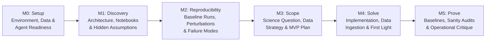

# Workshop Facilitator & Participant Guide: The "Missing Manual" Exercise

## 1. Philosophy: A "Missing Manual" Workshop (Not a Traditional Tutorial)

This workshop is intentionally framed as a **"Missing Manual" exercise**, rather than a traditional step-by-step tutorial.

In a conventional tutorial, participants follow a pre-scripted path (`Shift+Enter` through polished cells) where every parameter choice, data format, and edge case has already been smoothed over. While that shows a tool under ideal conditions, it rarely prepares researchers to answer their own science questions—and it hides the real operational bottlenecks of the software.

In a **Missing Manual** exercise, participants act as **scientific test pilots and co-authors of the documentation the toolkit is still missing**:
1. **Understand and Stress-Test the Materials**: Participants explore the repository, its example notebooks, data loaders, and pretrained models/artifacts to figure out how the system is actually built and what scientific assumptions are baked into the code.
2. **Pursue a Real Science Question of Choice**: Rather than staying on the rails of the demo examples, participants attempt to formulate, scope, and implement a scientific question of their own using the workshop tools and datasets.
3. **Compare Human Reasoning with Coding Agent Assistance**: In every session, challenges are split **50/50** between:
   - **Participant-Led Challenges (Independent Thinking & Implementation)**: Tasks participants think through, inspect, or implement by themselves to build direct intuition and experience the raw friction of the repo and notebooks.
   - **Coding-Agent Challenges (Claude Code / Antigravity)**: Tasks where participants partner with an AI coding agent (such as **Claude Code** or **Antigravity**) to explain repository components, strategize how to tackle a scientific question, or implement and audit code and notebook changes.
4. **Deliver a Critical Operational Judgment**: Friction is treated as high-value signal, not user error. Whenever a participant has to guess a unit convention, dig through source files to understand a parameter, work around a silent bug, or correct a coding agent's hallucination, they record it. By the end of the workshop, participants deliver a critical evaluation of the toolkit's **usability, documentation gaps, agent-readiness, and operational maturity** so the platform can be systematically improved.

---

## 2. Workshop Sessions at a Glance (`M0` to `M5`)

| Session | Focus | Participant Role | Coding Agent Role (Claude Code / Antigravity) | "Missing Manual" Output |
|---|---|---|---|---|
| **M0: Setup** | Environment, dependencies, data access, and agent configuration | Operator & First-Time User Tester | Environment Diagnostics & Repo Orientation Assistant | Onboarding friction log & setup gap checklist |
| **M1: Discovery** | Mapping the codebase, example notebooks, pretrained artifacts, and physical assumptions | Scientific Investigator | Codebase Explainer & Architecture Mapper | Undocumented conventions, hidden assumptions & API map |
| **M2: Reproducibility** | Re-running existing notebooks, perturbing parameters/events, and spotting silent breakages | Experimentalist | Execution Navigator & Perturbation Assistant | Reproducibility scorecard & brittle-assumption log |
| **M3: Scope** | Formulating a custom science question and designing a realistic implementation strategy | Principal Investigator | Strategic Sounding Board & Workflow Planner | Scope feasibility notes & missing capability gaps |
| **M4: Solve** | Implementing the science workflow across notebooks/code, ingesting data, and generating results | Developer & Domain Driver | Pair Programmer & Notebook/Code Implementer | API ergonomics review & agent failure/recovery log |
| **M5: Prove** | Validating results against baselines, auditing for circularity/leakage, and synthesizing critique | Scientific Referee & Critic | Hostile Reviewer & Verification Auditor | Validated science findings + **The Missing Manual Report** |

---

## 3. Session-by-Session Guide & Facilitator Challenges

Each session below includes **6 facilitator-suggested challenges**:
- **3 Participant-Led Challenges** (for participants to think through, inspect, or implement by themselves)
- **3 Coding-Agent Challenges** (for participants to execute by interacting with a coding agent like **Claude Code** or **Antigravity**)

---

### M0: Setup

#### Session Overview
Before diving into science, participants bring up the software environment, verify access to local or remote datasets and pretrained model checkpoints/artifacts, open the Jupyter notebooks, and connect their coding agent (**Claude Code** or **Antigravity**) to the workspace. Under the **Missing Manual** lens, `M0` is an unvarnished audit of the repository's "Day-Zero Onboarding Experience": what works out of the box, what fails silently, and what prerequisite knowledge the README forgot to mention.

#### Suggested Challenges (6 Total: 3 Participant-Led + 3 Coding-Agent)

##### Part A: Participant-Led Challenges (Think & Implement Yourself)
1. **Challenge M0-P1 — The "Cold-Start README" Test**:
   Follow the repository's `README.md` (and any environment setup instructions) literally, without asking the coding agent or a neighbor for help. Time how long it takes to activate the environment, import the core package in Python, and open the first notebook. Write down every step where you had to guess a command, fix a path, or set an undocumented environment variable.
2. **Challenge M0-P2 — Manual Data & Artifact Inventory Check**:
   Browse the data, model checkpoints, or catalog directories manually (via terminal or file browser) and open one sample file in a scratch notebook cell using standard Python tools (`h5py`, `xarray`, `astropy`, `pandas`, or `zarr`). Inspect its shape, keys, and metadata attributes yourself, and check whether those details are documented anywhere in the repo.
3. **Challenge M0-P3 — Write Your Own 5-Line Smoke Test**:
   In a scratch cell or short script, write a 5-line sanity check by hand that imports the toolkit, loads a minimal data sample or model artifact, and prints its version, device (CPU/GPU), and output shape. Note how intuitive (or unintuitive) the top-level package imports are when writing them from scratch without autocomplete or agent help.

##### Part B: Coding-Agent Challenges (Interact with Claude Code / Antigravity)
4. **Challenge M0-A1 — Repo Orientation & Setup Walkthrough**:
   Ask your coding agent to inspect the repository layout and explain how the environment, data paths, and notebooks are wired together:
   > *"Explain what the environment setup scripts, configuration files, and top-level folders in this repo do, and tell me the exact sequence of commands required to verify that my environment, data paths, and pretrained artifacts are properly configured."*
5. **Challenge M0-A2 — Automated Environment & Dependency Diagnostic**:
   Have the coding agent design and run a diagnostic check across the repo's dependencies, hardware visibility, and required data files:
   > *"Implement a quick setup verification script (or notebook cell) that checks whether all required Python packages, environment variables, sample datasets, and model checkpoints referenced by the notebooks are present and loadable, and report any missing or mismatched items."*
6. **Challenge M0-A3 — Auditing the Repo's Context for Agents**:
   Ask the coding agent to evaluate how well the repository explains itself to an AI assistant on first contact:
   > *"Read the repository's `README.md` and any agent instruction files (`CLAUDE.md`, `GEMINI.md`, `AGENTS.md`). What critical setup details, data path conventions, or execution rules are missing or ambiguous if you were asked to run and modify the notebooks in this repo?"*

#### "Missing Manual" Reflection for `M0: Setup`
- Which installation steps, credentials, data downloads, or hardware assumptions were undocumented or fragile?
- Did the coding agent immediately understand how to run code in this environment, or did it stumble over virtual environments, kernels, or relative paths?

---

### M1: Discovery

#### Session Overview
In `M1: Discovery`, participants investigate the scientific and software architecture of the repository: how raw observations or catalogs are ingested, what preprocessing and calibration transformations are applied, how pretrained models or derived artifacts are structured, and how the tutorial notebooks fit together. Rather than treating the toolkit as a black box, participants look for the **hidden scientific assumptions**—units, coordinate frames, cadence rules, quality masks, and normalizations—and compare what they discover by reading the code themselves against what a coding agent extracts.

#### Suggested Challenges (6 Total: 3 Participant-Led + 3 Coding-Agent)

##### Part A: Participant-Led Challenges (Think & Implement Yourself)
1. **Challenge M1-P1 — Manual End-to-End Variable Trace**:
   Pick one core tutorial notebook and trace a single physical quantity (e.g., an instrument channel, magnetic field component, or flux time series) by hand from raw file loading down to model input or plot generation. Open the underlying `.py` source files yourself and record the exact physical units, array shapes, and coordinate systems at each step.
2. **Challenge M1-P2 — Uncovering Three Hidden Domain Assumptions**:
   By reading the docstrings and source code of the preprocessing or evaluation modules yourself, identify **three scientific or operational assumptions** that are hardcoded or implicitly assumed (e.g., exposure-time normalization, limb masking thresholds, missing-value sentinels, cadence alignment tolerances, or train/test splitting buffers) that a domain scientist could easily overlook.
3. **Challenge M1-P3 — Sketch the "Missing Architecture Diagram"**:
   On paper or in markdown, draw your own mental map of the repository showing how `data/` $\to$ `src/` modules $\to$ `models/artifacts` $\to$ `notebooks/` connect, marking which parts of the codebase feel clear and modular versus which parts feel opaque, tightly coupled, or poorly named.

##### Part B: Coding-Agent Challenges (Interact with Claude Code / Antigravity)
4. **Challenge M1-A1 — Deep-Dive Explanation of a Repo Module or Notebook**:
   Ask your coding agent to explain a specific module or notebook in detail, citing exact files and line numbers:
   > *"Explain what `XXX` part of the repo or notebooks do (e.g., the data preprocessing pipeline in `notebooks/02_...` and `src/...`). For each step, state its scientific purpose, the exact input/output shapes and physical units, and cite the `file:line` where each transformation happens."*
5. **Challenge M1-A2 — Cross-Checking Docstrings Against Actual Implementation**:
   Use the coding agent to hunt for discrepancies between what the documentation/markdown cells claim and what the Python code actually executes:
   > *"Compare the markdown explanations in notebook `XXX` and the docstrings in module `YYY` against the actual Python implementation. Identify any undocumented parameters, silent default behaviors, unit conversions, or edge cases where the code does something the prose does not mention."*
6. **Challenge M1-A3 — Mapping Pretrained Models & Artifacts to Scientific Tasks**:
   Ask the coding agent to catalog all available models, embeddings, or catalogs in the repo and explain how they can be used:
   > *"Explain what pretrained models, checkpoints, embeddings, and catalogs exist in this repo, how the example notebooks load and run them, and what inputs and outputs each artifact expects."*

#### "Missing Manual" Reflection for `M1: Discovery`
- Where did you have to read raw Python source code because the notebook markdown or docstrings omitted critical scientific details (units, coordinate frames, scaling, masking)?
- Did the coding agent accurately explain the codebase, or did any misleading variable names / stale comments cause the agent to misinterpret the physics?

---

### M2: Reproducibility

#### Session Overview
Before building anything new, a scientist must verify whether the existing materials actually reproduce their claimed outputs and understand how sensitive they are to small changes. In `M2: Reproducibility`, participants execute the reference notebooks end-to-end, compare reproduced outputs against committed figures/metrics, and perform controlled **perturbations** (changing a date range, event ID, instrument channel, or threshold) to see where the pipeline holds up and where it breaks.

#### Suggested Challenges (6 Total: 3 Participant-Led + 3 Coding-Agent)

##### Part A: Participant-Led Challenges (Think & Implement Yourself)
1. **Challenge M2-P1 — Clean-Kernel Execution & Diff Audit**:
   Restart the Jupyter kernel and run a complete reference notebook from top to bottom yourself. Compare every generated number, warning message, table, and plot against the pre-rendered outputs committed in the repository. Document any differences in runtime, numerical precision, warnings, or random seeds.
2. **Challenge M2-P2 — Manual Single-Variable Perturbation**:
   Pick one meaningful scientific parameter in an existing notebook (for example, switching to a different benchmark event/date interval, changing a forecast horizon, or toggling a calibration step) and modify the code yourself to run it. Observe what breaks (hardcoded array sizes, missing files, unscaled axes) and interpret whether the resulting physical output makes sense.
3. **Challenge M2-P3 — Planted Edge-Case Stress Test**:
   By yourself, feed the notebook or a core toolkit function a realistic domain edge case—such as an interval containing a data gap/eclipse, a quiet/negative-control period, or an extreme limb event. Observe whether the toolkit raises a helpful error, handles it gracefully, or silently produces corrupt numbers.

##### Part B: Coding-Agent Challenges (Interact with Claude Code / Antigravity)
4. **Challenge M2-A1 — Automated Notebook Execution & Warning Triage**:
   Ask your coding agent to execute a reference notebook and analyze all runtime outputs and warnings:
   > *"Run notebook `XXX` end-to-end without changing its logic. Report the execution time, summarize the key output metrics and figures, and explain what every warning or log message emitted during execution means scientifically and operationally."*
5. **Challenge M2-A2 — Implementing a Perturbed Notebook Variant**:
   Instruct the coding agent to adapt an existing notebook to run on a new event, time window, or parameter regime:
   > *"Implement a modified version of notebook `XXX` that runs the workflow on event/date range `YYY` (or with parameter `ZZZ` changed). Before editing, list every cell and hardcoded assumption that needs to be updated, apply the changes in a new notebook copy, run it, and compare the new outputs against the original baseline."*
6. **Challenge M2-A3 — Diagnosing Why a Perturbation Failed or Changed**:
   When a modified run produces an error or an unexpected scientific shift, ask the coding agent to trace the root cause:
   > *"Explain why changing `XXX` in notebook `YYY` caused the output metrics/predictions to change (or fail) the way they did. Trace the behavior back to the underlying functions in the repo and tell me whether this is a real physical effect or an artifact of how the code is written."*

#### "Missing Manual" Reflection for `M2: Reproducibility`
- Were the reference notebooks truly reproducible out of the box, or did they rely on hidden state, hardcoded paths, or unpinned seeds?
- How easy was it to swap in a new date range or parameter? Which hardcoded assumptions in the notebooks should be refactored into configurable parameters?

---

### M3: Scope

#### Session Overview
In `M3: Scope`, the workshop pivots from exploring existing examples to **designing the participant's own scientific investigation**. Participants formulate a concrete science question of choice that they want to explore using the repository's tools, models, and artifacts. They then evaluate what data and code modifications are required, compare their own research design with strategies proposed by the coding agent, and scope a **Minimum Viable Science Plan** achievable within the workshop timeframe—while explicitly noting where the toolkit makes their question easy versus where the toolkit gets in the way.

#### Suggested Challenges (6 Total: 3 Participant-Led + 3 Coding-Agent)

##### Part A: Participant-Led Challenges (Think & Implement Yourself)
1. **Challenge M3-P1 — Formulate Your Science Question & Physical Hypothesis**:
   Without using the coding agent, write down a concise scientific question or operational hypothesis you want to test using this repository (e.g., evaluating model skill across specific physical regimes, testing sensitivity to an input channel or calibration step, or combining project predictions/embeddings with an external catalog). Define your target metric, baseline for comparison, and what a meaningful result plot ("First-Light Plot") would look like.
2. **Challenge M3-P2 — Manual Feasibility & Data Budget Estimate**:
   Inspect the available datasets (local caches, remote archives, or your own external dataset) yourself and calculate the back-of-the-envelope data volume, time coverage, sample size, and compute runtime required for your idea. Decide yourself what must be cut or simplified so the experiment runs in minutes rather than hours.
3. **Challenge M3-P3 — Draft Your Independent 5-Step Implementation Plan**:
   Before asking the agent for a strategy, sketch your own 5-step execution plan mapping your science question to the repository's existing notebooks and functions. Note which steps you already know how to do with the repo and which steps feel unclear or unsupported.

##### Part B: Coding-Agent Challenges (Interact with Claude Code / Antigravity)
4. **Challenge M3-A1 — Agent Strategy for Solving Your Science Question**:
   Ask the coding agent to propose an end-to-end technical and scientific strategy grounded in the repository:
   > *"Give me a strategy on how I would approach solving science question `XXX` following the notebook examples and this repo. Specify which existing notebooks, toolkit functions, and pretrained models/artifacts I should reuse, what new code or data adapters I would need to write, and what order of steps I should follow."*
5. **Challenge M3-A2 — Skeptical Scope & Pitfall Review**:
   Use the coding agent as a critical collaborator to stress-test your proposed plan before writing code:
   > *"Review my proposed plan for answering science question `XXX` using this repo. Act as a skeptical scientific collaborator: point out any hidden data bottlenecks, unit/coordinate mismatches, temporal leakage risks, or missing toolkit capabilities that could derail this plan within a 2-hour coding sprint, and suggest a simpler MVP fallback."*
6. **Challenge M3-A3 — External Data / Custom Input Compatibility Assessment**:
   If your question involves a new event slice, catalog, or external dataset, ask the coding agent to design the integration contract:
   > *"Explain how I would integrate dataset/catalog `XXX` with the models and artifacts in this repo. What exact timestamps, coordinate frames, physical units, and schema formats does the repo require, and what adapter steps are needed?"*

#### "Missing Manual" Reflection for `M3: Scope`
- When you tried to map your own science question onto the repository, what was the biggest architectural obstacle or missing extension point?
- Compare your independent plan (`M3-P3`) with the coding agent's proposed strategy (`M3-A1`): where did the agent spot useful repo utilities you missed, and where did the agent propose something scientifically naive or overly complex?

---

### M4: Solve

#### Session Overview
In `M4: Solve`, participants execute their scoped plan to answer their science question—ingesting/caching their target data slice, adapting or extending notebook workflows and helper code, running pretrained model inference or artifact analyses, and generating their diagnostic and result figures. By intentionally alternating between **hand-written implementation** and **agent-driven implementation**, participants experience firsthand both the developer ergonomics of the toolkit and how effectively coding agents can write working scientific code against it.

#### Suggested Challenges (6 Total: 3 Participant-Led + 3 Coding-Agent)

##### Part A: Participant-Led Challenges (Think & Implement Yourself)
1. **Challenge M4-P1 — Implement the Core Scientific Metric or Transformation Yourself**:
   Pick the single most domain-critical piece of your analysis (for example, defining the physical event filter, computing the domain skill metric, or applying a physical scaling/masking rule) and write that function or notebook cell yourself by hand. Pay close attention to how easy or frustrating the toolkit's data structures and APIs are to manipulate directly.
2. **Challenge M4-P2 — Manual Physical Sanity Check on Intermediate Tensors/Tables**:
   Before trusting any model output or summary plot, write a short interactive inspection cell yourself to check the physical min/max/median values, units, `NaN` fractions, and timestamp alignment of your intermediate data arrays. Verify by hand that the numbers match physical reality.
3. **Challenge M4-P3 — Code Review & Refactoring of Agent-Generated Code**:
   Read every line of code or notebook modification generated by your coding agent during this session. Identify at least one place where the agent wrote verbose boilerplate, bypassed an existing toolkit function, hardcoded a magic number, or made a questionable physical assumption—and clean it up or redirect it yourself.

##### Part B: Coding-Agent Challenges (Interact with Claude Code / Antigravity)
4. **Challenge M4-A1 — Implementing Data Ingestion & Pipeline Logic**:
   Ask the coding agent to implement a specific component of your planned workflow in the notebook or a companion `.py` module:
   > *"Implement `XXX` in the notebook or code (for example: fetch/load the target dataset for `YYY`, align it with the repo's pretrained model/artifacts, and compute `ZZZ`), following the patterns in `@notebooks/...` and reusing the functions in `@src/...`. Show me a brief plan first, then implement and run it."*
5. **Challenge M4-A2 — Implementing the "First-Light" Diagnostic Visualization**:
   Have the coding agent build a multi-panel diagnostic figure that pairs physical inputs with model predictions or derived artifacts:
   > *"Implement a diagnostic visualization cell in my notebook that plots the calibrated physical inputs alongside the model predictions/artifacts and target catalog over my study interval `XXX`, complete with physical units on all axes, UTC timestamps, and saved output in `figures/`."*
6. **Challenge M4-A3 — Debugging & Fixing a Runtime or Scientific Obstacle**:
   When you hit an API error, shape mismatch, or unexpected output during implementation, task the coding agent with diagnosing and resolving it:
   > *"I am trying to implement `XXX` in my notebook, but I am getting error/behavior `YYY`. Inspect the traceback and the relevant toolkit source code in `@src/...`, explain the root cause, and implement a clean fix."*

#### "Missing Manual" Reflection for `M4: Solve`
- Where did the toolkit's API design help you move fast, and where did inconsistent function signatures, rigid data structures, or unhelpful error messages slow you down?
- What mistakes did the coding agent make when writing code against this repo (e.g., inventing non-existent methods, misusing units, writing raw boilerplate instead of calling toolkit helpers), and what guardrails or docstrings would have prevented them?

---

### M5: Prove

#### Session Overview
Generating a plausible-looking plot is easy—especially with an AI coding agent—but proving that the result is **scientifically valid, statistically sound, and free of methodological bugs** is what separates exploratory hacking from publishable science. In `M5: Prove`, participants subject their `M4` implementation to rigorous scientific validation (baseline comparisons, leakage/alignment audits, uncertainty checks, and negative controls) and synthesize their experience across `M0`–`M5` into their final **Missing Manual Critical Judgment**.

#### Suggested Challenges (6 Total: 3 Participant-Led + 3 Coding-Agent)

##### Part A: Participant-Led Challenges (Think & Implement Yourself)
1. **Challenge M5-P1 — Design Your Own "Null / Negative Control" or Known-Event Test**:
   Think of one domain-specific test where you know from physics what the answer *must* be (e.g., a quiet solar-minimum period where flare probability should be near zero, a scrambled-time null test, or a well-known benchmark event). Run your pipeline on that case yourself and judge whether the results behave physically.
2. **Challenge M5-P2 — Manual Audit of Baselines & Error Bars**:
   Inspect your final comparison table and plots yourself. Can you explain, without asking the agent, how your result compares to a naive domain baseline (such as Persistence or Climatology) and whether the uncertainty intervals account for physical autocorrelation (e.g., solar rotation or event clustering)?
3. **Challenge M5-P3 — Authorship of the "Missing Manual" Critique & Maturity Scorecard**:
   Synthesize your notes from `M0` through `M5` into a concise, candid **"Missing Manual" evaluation** of the repository. Score and critique:
   1. **Onboarding & Reproducibility (`M0`–`M2`)**: What broke or was undocumented?
   2. **Extensibility for New Science (`M3`–`M4`)**: What was hard to adapt for your custom science question?
   3. **Agent-Readiness**: Where did Claude Code / Antigravity succeed or fail when working with this codebase?
   4. **Top 3 Concrete Recommendations**: What are the three highest-impact improvements the development team should make to the code, documentation, or guardrails?

##### Part B: Coding-Agent Challenges (Interact with Claude Code / Antigravity)
4. **Challenge M5-A1 — Automated Methodological & Leakage Audit**:
   Ask the coding agent to audit your notebook and code for subtle scientific and statistical bugs:
   > *"Audit my notebook and helper code in `XXX` for methodological flaws: check for forecast lookahead / temporal leakage, timestamp or cadence misalignment, improper handling of `NaN`/dropout intervals, unit mismatches, or threshold tuning on evaluation data. Cite exact cells and `file:line` numbers."*
5. **Challenge M5-A2 — Implementing Domain Baselines & Uncertainty Quantification**:
   Instruct the coding agent to add fair baseline comparisons and confidence intervals to your analysis:
   > *"Implement a validation section in my notebook that compares my results on `XXX` against the domain baselines in this repo (e.g., Persistence and Climatology) over the exact same evaluation timestamps, and adds block-bootstrapped confidence intervals to the final metrics table and plot."*
6. **Challenge M5-A3 — The "Hostile Journal Referee" Stress Test**:
   Prompt the coding agent to critique your findings as a skeptical domain reviewer and help you draft the final summary:
   > *"Act as a hostile journal referee reviewing my notebook and results on science question `XXX`. Identify the top 3 scientific or statistical weaknesses in my analysis, propose one quick empirical check I can run right now in the notebook to address the most serious critique, and then help me summarize both my scientific findings and the toolkit friction points we encountered."*

#### "Missing Manual" Reflection for `M5: Prove`
- Did the validation and audit step uncover any silent bugs or over-optimistic results that looked convincing at the end of `M4`?
- Looking across the entire workshop (`M0` to `M5`), what needs to be added to the repository's code, tests, documentation, and agent instructions so the *next* scientist (and their coding agent) can go from setup to validated science with half the friction?

---

## 4. Facilitator Template: Harvesting the "Missing Manual" Feedback

At the end of `M5: Prove`, facilitators collect two deliverables from each participant or pod:
1. **The Scientific Attempt & Verdict**: What science question did you pursue, how far did you get using the notebooks and tools, and what did you find (even if the result was negative or blocked by a tool limitation)?
2. **The "Missing Manual" Field Report**:

| Category | What Worked Well | What Was Missing, Confusing, or Broken | Concrete Action Item for Repo Maintainers |
|---|---|---|---|
| **Setup & Data Access (`M0`)** | | | |
| **Code & Notebook Clarity (`M1`)** | | | |
| **Reproducibility & Configurability (`M2`)** | | | |
| **Adapting to Custom Science Questions (`M3`–`M4`)** | | | |
| **Coding Agent Interaction (Claude Code / Antigravity)** | | | |
| **Validation, Baselines & Guardrails (`M5`)** | | | |
