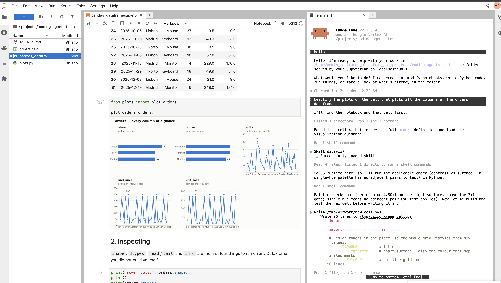

# AI Assistant integration with Juputer notebookes

## install

`jupyter_client` 

## Option 1: Remote notebook server + local AI assistant

**In remote VM**:
- connect to VM via ssh and configure tunnel i.e. remote 8811 == local 8833
- cd to a selected folder and clone tutorial repo
- install `pip install jupyter-collaboration`  to allow automatic refreshing open notebooks
  when changed on disk.
- launch `jupiter-lab` on VM on port 8811 (use screen or tmux to keep it running)

**In local machine**:
- point your local browser to localhost:8833 to manual interact with notebooks
- cd to a selected folder and create AGENTS.md with following content:
  
      the contents of the current folder are exposed through a jupyter-lab server running 
      on localhost:8833 from my home folder. refer any code question that I make to this
      folder, like running, modifying or creating notebooks, python code, documents, etc.
  
- start your AI Assistant (CLI or desktop)

## Option 2: Remote notebook server + remote AI assistant

**In remote VM**:
- connect to VM via ssh and configure tunnel i.e. remote 8811 == local 8833
- cd to a selected folder and clone tutorial repo
- install `pip install jupyter-collaboration`  to allow automatic refreshing open notebooks
  when changed on disk
- launch `jupyter-lab`  on VM on port 8811 (use screen or tmux to keep it running)
- In the cloned repo folder create AGENTS.md with following content:

      the contents of the current folder are exposed through a jupyter-lab server running 
      on localhost:8811 from my home folder. refer any code question that I make to this
      folder, like running, modifying or creating notebooks, python code, documents, etc.

**In local machine**:
- point your local browser to localhost:8833 to manual interact with notebooks
- in `jupyeter-lab` in your browser open a terminal window side-by-side with your notebook
- in the terminal window cd to the folder with clone repo and start your AI assistant CLI

## Option 3: With local VSCode
- ssh to the remove VM and clone the tutorial repo
- open the remote server VM in VSCode and go to the folder with the cloned repo
- install the VSCode extension of your AI assistant

