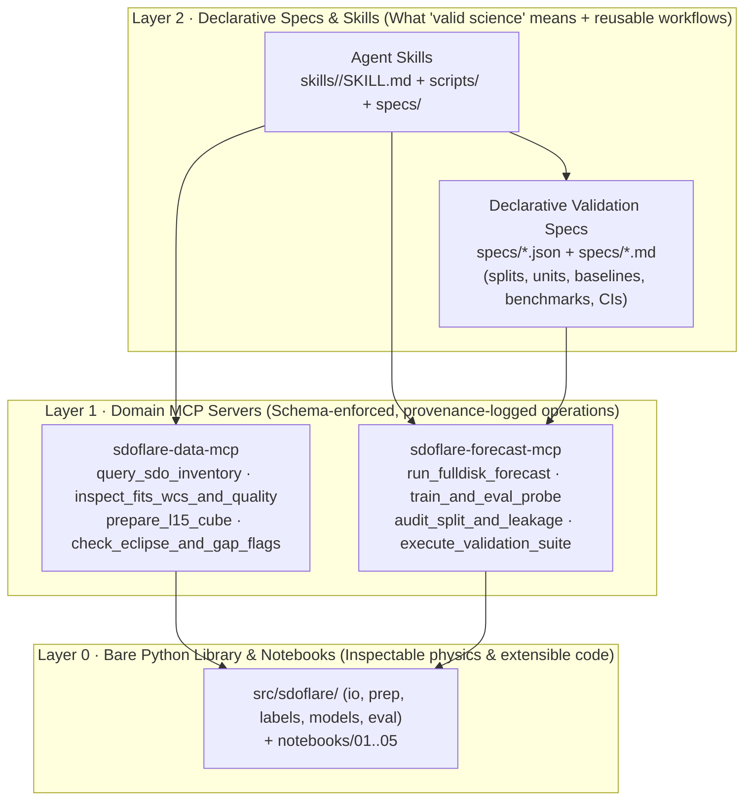
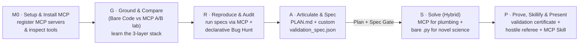

# Heliophysics Toolkit Workshop — Methodology & Facilitator Guide (AI-Mature Toolkit Edition)

> [!IMPORTANT]
> **About the worked examples (`sdoflare`):** Throughout this guide and the companion **Participant Handouts** and **Toolkit Developer Guide**, all concrete examples, MCP servers, declarative validation specs, prompts, bug-hunt scenarios, and skill-creation tasks use an **imaginary Python package called `sdoflare`** — a hypothetical, AI-mature toolkit for preprocessing full-disk **SDO/AIA** (EUV) and **SDO/HMI** (magnetogram) images and running **operational solar flare prediction models** evaluated against the **GOES XRS** flare catalog.
>
> `sdoflare` is an **illustrative stand-in** so you can see how an AI-mature scientific toolkit (combining a Python library, **MCP servers**, **declarative validation specifications**, and **Agent Skills**) is taught and used in a 1.5-day workshop. Replace `sdoflare`'s names, tools, and domain specs with your own using the mapping table in **§2**.

---

## 1. Design goals and what "success" means

| Goal | Evidence at the end of the 1.5-day workshop |
|---|---|
| Scientists **understand the toolkit across all three layers** (bare Python code, MCP servers, and declarative validation specs) | They can explain *without* the agent when to invoke an MCP tool, when to edit a declarative `validation_spec.json`, and when to drop down to bare `src/sdoflare/` Python code |
| Scientists **install and use MCP servers** inside their coding agent and see **why MCP beats bare-code prompting** for standard operations | In Module 1 (`G1` vs `G2`), they run the same SDO calibration + baseline task first on bare code and then via MCP, measuring glue-code reduction, schema-blocked domain errors, and provenance receipts |
| Scientists **define machine-checkable validation before modeling** | At the Module 3 Plan Gate, every participant has both a human `PLAN.md` and a validated `work/<name>/validation_spec.json` (`specs/` schema) that locks in their split buffer, baselines, physical bounds, and benchmark events before writing model code |
| Scientists **solve their science case** using the **Hybrid Pattern** (*MCP for plumbing & validation, bare Python for novel science*) | A reproducible MVP that passes `execute_validation_suite` (producing a `PASS` `validation_certificate.json`) and survives a hostile-referee test |
| Scientists **package their workflow as an MCP-backed Agent Skill** for other science users | A validated `skills/<skill-name>/SKILL.md` + CLI script + declarative validation spec (`specs/<skill>.json`) verified by a pod-mate in a fresh agent session |
| Organizers get **toolkit, MCP & spec feedback + a community skill catalog** | Structured issues on missing MCP tool parameters, bare-API gaps, and 12–20 reusable skills + declarative validation specs |

---

## 2. Architecture of an AI-mature heliophysics toolkit (`sdoflare`)

An AI-mature scientific toolkit does not force a coding agent to read thousands of lines of Python source code just to run a standard calibration or evaluation. Instead, it exposes **three complementary layers**:

### The core mental model participants must learn: *MCP vs. Declarative Specs vs. Bare Code*

| Layer | What it is best at | What goes wrong if you use Bare Code instead | When scientists **MUST** drop down to Bare Code (`src/sdoflare/`) |
|---|---|---|---|
| **MCP Servers** (`sdoflare-data-mcp`, `sdoflare-forecast-mcp`) | Standard data inventory lookup, Level 1.5 calibration, eclipse/gap filtering, baseline runs, attribution, and executing validation suites | Coding agent writes 60+ lines of fragile `sunpy`/`astropy` glue code, divides by `EXPTIME` twice, stacks mismatched timestamps, or floods the context window | When inventing a **new** physical feature, custom coronal mask, custom loss function, or custom model head not exposed as an MCP tool parameter |
| **Declarative Validation Specs** (`specs/*.json`, `specs/*.md`) | Locking in split rules (`carrington_buffer_days >= 27`), physical unit bounds, required baselines, validation-only thresholds, and benchmark events *before* coding | Agent subtly shifts evaluation rules mid-session, tunes thresholds on the test set, or forgets quiet-Sun negative controls | When exploratory plotting or debugging an intermediate array shape before formal evaluation |
| **Bare Python Library** (`src/sdoflare/*.py` + `work/<name>/src/*.py`) | Inspecting exact equations (`file:line`), writing novel scientific logic, and unit-testing custom transformations | N/A — this is the right layer for novel science, *paired* with MCP for data plumbing and declarative validation | Always use bare Python in `work/<name>/src/*.py` for the novel scientific hypothesis of your workshop project |

### Mapping imaginary `sdoflare` components to your real toolkit

| Imaginary `sdoflare` component | Concrete examples in this guide | What you substitute for your real toolkit |
|---|---|---|
| **Layer 0: `src/sdoflare/`** | `io`, `prep` (`aia_l1_to_l15`, `correct_aia_degradation`, `correct_hmi_projection`), `labels` (`carrington_split`), `models` (`FullDiskFlareNet`, `LinearProbeForecaster`, `PersistenceBaseline`), `eval` (`compute_tss_hss`) | Your core Python modules, classes, and tutorial notebooks (`notebooks/01`–`05`) |
| **Layer 1: `sdoflare-data-mcp`** | Tools: `query_sdo_inventory`, `inspect_fits_wcs_and_quality`, `prepare_l15_cube`, `check_eclipse_and_gap_flags`. Resources: `sdoflare://data/manifest`, `sdoflare://calibration/aia_degradation_v10` | Your data-discovery, metadata-inspection, and preprocessing MCP server |
| **Layer 1: `sdoflare-forecast-mcp`** | Tools: `run_fulldisk_forecast`, `train_and_eval_probe`, `run_baselines`, `attribute_active_regions`, `audit_split_and_leakage`, `execute_validation_suite`. Resources: `sdoflare://models/registry`, `sdoflare://specs/catalog` | Your model inference, probing, attribution, and validation MCP server |
| **Layer 2: `specs/*.json` & `specs/*.md`** | `specs/operational_24h_m10_validation.json` + `.md`, `specs/preprocessing_contract.json`, `specs/validation_spec.schema.json` | Your declarative JSON/Markdown validation protocols and JSON Schemas |
| **Layer 2: `skills/`** | Reference `skills/sdo-ar-event-attribution/` + participant-built `sdo-euv-channel-ablation`, `sdo-limb-foreshortening-audit`, `sdo-preflare-flux-probe` | Reusable Agent Skills that combine MCP calls, custom `.py` CLIs, and declarative specs |

---

## 3. The updated GRASP ladder

| Module / Rung | Agent mode | Scientist role | Time share |
|---|---|---|---|
| **M0 · Setup & MCP Install** | Bare CLI → MCP-connected CLI | Installer; registers MCP servers, inspects schemas, runs health checks | ~8% |
| **M1 · Ground & Compare** (`G`) | **Run A**: Bare code only **Run B**: MCP + Declarative Spec | Experimenter; compares glue code, token cost, schema safety & provenance; verifies `file:line` citations | ~12% |
| **M2 · Reproduce & Audit** (`R`) | Navigator (MCP + `papermill`) | Operator; perturbs declarative config & runs declarative validator on 3 broken bug-hunt notebooks | ~10% |
| **M3 · Articulate & Spec** (`A`) | Skeptical collaborator (**no code**) | PI; authors `PLAN.md` **and** `work/<name>/validation_spec.json` (`A2`) before coding | ~10% |
| **M4 · Solve (Hybrid)** (`S`) | Pair programmer (MCP + `.py`) | Architect; uses MCP tools for data/baselines and writes bare `.py` only for the novel scientific step | ~35% |
| **M5–M6 · Prove & Skillify** (`P`) | Declarative auditor → Hostile referee → Skill architect | Defender & skill author; earns `validation_certificate.json`, runs referee test, packages MCP-backed `SKILL.md` | ~25% |

---

## 4. The Agent Operating Contract (AI-Mature Edition)

Printed as a one-page card (Handout `H0`) and enforced by facilitators:
1. **Use the right layer for the job (MCP first for plumbing, bare Python for novel physics).** Never let the agent write custom FITS loaders, degradation loops, or metric scripts when an MCP tool (`sdoflare-data-mcp`, `sdoflare-forecast-mcp`) already exposes that operation with schema validation and provenance logging. Drop down to bare `src/sdoflare/` Python code in `work/<name>/src/*.py` **only** for the novel scientific logic of your project.
2. **Ground every bare-code ask.** When inspecting or extending `src/sdoflare/`, point at `@src/sdoflare/...` and `@notebooks/...`, require `file:line` citations, and open at least one citation.
3. **Lock in your declarative validation spec (`validation_spec.json`) before modeling.** Define your split buffer, physical unit bounds, baselines, benchmark events, and threshold rule in `work/<name>/validation_spec.json` in Module 3. Never weaken the spec to make a failing model pass.
4. **Plan before code, one step at a time.** Approve the plan (which MCP tools + which `.py` function will be called) before edits.
5. **Verify with both the declarative suite AND a hostile referee.** Passing `execute_validation_suite` is necessary but not sufficient — always inspect your First-Light plot (`S2`) and run at least one case-specific referee test (`P4`).
6. **You own the physics.** Scientific hypotheses, physical interpretations, and what goes into `validation_spec.json` are human decisions.
7. **Log the misses — then bake them into your Skill and Validation Spec.** Every agent or pipeline error goes into `ERROR_LOG.md` and becomes a declarative rule or guardrail in your Module 6 Skill.

---

## 5. Schedule at a glance (1.5 days)

Assumes 12–24 scientists in **pods of 3–4** by science theme, 1 facilitator per ~8 participants.

### Day 1 (09:00–17:30)

| Time | Block | Agent configuration | Facilitator focus |
|---|---|---|---|
| 09:00–09:25 | **Kickoff & Live Calibration Demo** (§6.0) | Bare Code vs MCP live on screen | Show an undirected bare-code failure ($\text{TSS}=0.91$ leak) vs MCP schema rejection & declarative audit |
| 09:25–09:45 | **The 3-Layer `sdoflare` Architecture (20 min)** | — | Walk through Layer 0 (`src/`), Layer 1 (`mcp/`), Layer 2 (`specs/`, `skills/`) |
| 09:45–10:30 | **M0 · Setup & MCP Server Installation** (`M0.1`–`M0.4`) | Install `sdoflare-data-mcp` & `sdoflare-forecast-mcp` | Verify everyone sees all MCP tools/resources via `/mcp` and `check_setup.py --with-mcp` |
| 10:30–11:45 | **M1 · GROUND & COMPARE** (`G1` Bare Code vs `G2` MCP Lab, `G3` Source Citation Check, `G4` Layer Decision Matrix) | Toggle MCP OFF (`G1`) → ON (`G2`–`G4`) | Run the 15-min pod debrief on *why* MCP + specs beat raw code generation for standard steps |
| 11:45–12:00 | Break | | |
| 12:00–13:00 | **M2 · REPRODUCE & DECLARATIVE BUG HUNT** (`R1`–`R3`) | MCP ON + `papermill` | Compare prose bug hunting vs deterministic detection via `execute_validation_suite` (§6.2) |
| 13:00–14:00 | Lunch | | Stage any missing catalog/event slice in `data/` |
| 14:00–15:00 | **M3 · ARTICULATE & SPEC** (`A1` `PLAN.md`, `A2` `validation_spec.json` + `.md`, `A3` **Plan + Spec Gate**) | Skeptical collaborator (MCP read-only inventory tools allowed; **no code**) | Sign off on both `PLAN.md` and `validation_spec.json` (`env/validate_spec.py`) |
| 15:00–16:45 | **M4 · SOLVE, Sprint 1 (Hybrid)** (`S1`–`S5`; **First-Light checkpoint at 16:15**) | Pair programmer (MCP for plumbing + `.py` for novel step) | Prevent agents from re-writing MCP tools in Python; check First-Light plots at 16:15 |
| 16:45–17:15 | **Pod standups**: 2-min First-Light demo + "best error caught by MCP or human" | — | |
| 17:15–17:30 | **Wrap Day 1**: generate `HANDOFF.md` (`S6`) and `git commit` | — | |

### Day 2 (09:00–13:00)

| Time | Block | Agent configuration | Facilitator focus |
|---|---|---|---|
| 09:00–09:15 | **Re-entry**: read `PLAN.md`, `validation_spec.json`, `HANDOFF.md`; cut scope | MCP ON | Force scope cuts on anyone behind schedule |
| 09:15–10:40 | **M5 · SOLVE Sprint 2 (35m) + DECLARATIVE PROVE (50m)** (`P1`–`P5`) | Pair programmer → Declarative Auditor & Hostile Referee | Call **"pencils down on new model code" at 09:50**; require `validation_certificate.json` + 1 new referee rule added to `validation_spec.json` |
| 10:40–10:55 | Break | | |
| 10:55–11:40 | **M6 · PACKAGE & SKILLIFY** (`X1`–`X5`: clean run, `FINDINGS.md`, **distill MCP-backed `SKILL.md` + spec (`X3`)**, **pod-swap skill test (`X4`)**, feedback) | Skill architect | Ensure every skill bundles its declarative spec and passes `validate_skill.py` + fresh-session test |
| 11:40–12:35 | **Lightning talks** (5 min: Question → Hybrid Stack Used → Result & Certificate → Agent/MCP Story → Reusable Skill Demo) | — | Keep time strictly; highlight each new skill and declarative spec |
| 12:35–13:00 | **Retro & Harvest**: collect `skills/*`, `specs/*`, `ERROR_LOG.md`, MCP/toolkit issues | — | Merge validated skills and declarative specs into the community catalog |

---

## 6. Module-by-module facilitator playbook (with `sdoflare` examples)

### 6.0 Kickoff Calibration Demo script (10 minutes, live on screen)
1. **Scene 1 — Bare Code without MCP or Declarative Spec (4 min):**
   - Start the agent in a bare shell **with MCP disabled**. Prompt:
     > *"Load the 2014–2015 SDO data in `data/`, calibrate AIA 94/131/171 and HMI, train a 24h >=M1.0 flare model, and evaluate its TSS."*
   - Watch the agent write ~70 lines of custom Python that: (a) divides AIA by `EXPTIME` manually after calling `correct_aia_degradation()`, (b) uses `train_test_split(shuffle=True)` on 6-hour frames, and (c) prints **`TSS = 0.91`**.
2. **Scene 2 — Enabling `sdoflare-data-mcp` + `sdoflare-forecast-mcp` + `specs/operational_24h_m10_validation.json` (4 min):**
   - Enable the MCP servers and ask the agent to run `audit_split_and_leakage` and `execute_validation_suite` on the script it just wrote against `@specs/operational_24h_m10_validation.json`.
   - On screen, the MCP tool immediately returns **`STATUS: FAILED (3 critical violations)`**:
     - `VIOLATION 1 [SPLIT_BUFFER]`: `min_observed_gap_hours = 6.0 < required 648.0 (27.0 Carrington days) — NOAA AR 12192 present in both train and test.`
     - `VIOLATION 2 [PREPROCESSING]`: `Double EXPTIME normalization detected on channels ['aia_94', 'aia_131', 'aia_171'].`
     - `VIOLATION 3 [THRESHOLD_LEAKAGE]`: `Decision threshold 0.14 was optimized on test labels rather than validation split.`
   - Now ask the agent to perform the exact same task *using the MCP tools* (`prepare_l15_cube` $\to$ `train_and_eval_probe` $\to$ `execute_validation_suite`). It completes in 3 tool calls, writes zero glue code, and produces the true, leakage-free **`TSS = 0.64 ± 0.06`** with a signed `validation_certificate.json`.

---

### 6.1 M0 · Setup & Installing the MCP Servers (45 min)
- **Objective**: Every participant installs the toolkit's MCP servers into their coding agent, inspects the exposed tools/resources/prompts, and understands how the agent discovers them.
- **What participants do (`M0.1`–`M0.4` in Handouts)**:
  1. Run `python env/check_setup.py` (verifies Python package + offline `data/`).
  2. Start the coding agent *before* registering MCP and run `/mcp` (or ask what tools it has) — observe that it only has generic file/bash tools (`read_file`, `edit_file`, `run_command`).
  3. **Install & register the two MCP servers** (`sdoflare-data-mcp` and `sdoflare-forecast-mcp`) using `python env/install_mcp.py` (or the manual CLI commands `gemini mcp add ...` / `claude mcp add ...` so they see the exact JSON configuration added to `.gemini/settings.json` / `.mcp.json`).
  4. Restart/reload the agent, run `/mcp` to verify both servers show `CONNECTED`, and run `M0.4` to inspect the JSON Schemas of `prepare_l15_cube` and `execute_validation_suite`.
- **Facilitator notes**: Have participants open `.gemini/settings.json` (or `.mcp.json`) and actually read the 15-line `mcpServers` block so they see there is no magic—an MCP server is just a local stdio Python process (`python -m sdoflare.mcp.data_server`) speaking a structured tool protocol over stdin/stdout with `SDOFLARE_OFFLINE=1`.

---

### 6.2 M1 · GROUND & COMPARE: The Bare Code vs. MCP Lab (75 min)
- **Objective**: Give scientists direct empirical experience of **why** an MCP server + declarative validation spec is superior to bare-code prompting for standard domain workflows, AND **where** bare code is still required.
- **The 3-step activity (`G1`–`G4` in Handouts)**:
  - **`G1` (Bare-Code Run — 20 min)**: With a prompt constraint `"Do NOT call any sdoflare MCP tools; use only file reads and python scripts"`, participants ask the agent to inspect the Sep 2017 AR 12673 slice (`data/sdo_events/ar12673_201709/`), report any eclipse/quality dropouts, calibrate AIA 94/131/171 + HMI $B_{\text{los}}$ at `2017-09-06T06:00:00Z`, and compute the 24h $\ge\text{M1.0}$ forecast probability + attribution map.
  - **`G2` (MCP + Declarative Spec Run — 20 min)**: Participants now run the **exact same scientific task** allowing MCP tools (`inspect_fits_wcs_and_quality`, `prepare_l15_cube`, `run_fulldisk_forecast`, `attribute_active_regions`). Then they intentionally test schema enforcement by asking the agent to call `train_and_eval_probe` with `split_buffer_days=0` and `optimize_threshold_on="test"`—watching the MCP server reject the call before a single line of model code runs!
  - **`G3` (Peeking Under the Hood — 15 min)**: Participants ask the agent to trace which `src/sdoflare/*.py` functions (`file:line`) each MCP tool calls internally and verify 3 citations by opening the source files. (This prevents the MCP server from becoming an inscrutable black box!)
  - **`G4` (Personal Layer Decision Matrix — 15 min)**: Participants write `work/<name>/notes/my_architecture_map.md` splitting their own science case into:
    1. Steps handled by **`sdoflare-data-mcp` / `sdoflare-forecast-mcp`**,
    2. Rules locked into **`work/<name>/validation_spec.json`**, and
    3. Novel scientific logic they will write in **bare Python (`work/<name>/src/*.py`)**.

#### Facilitator Debrief Table (write on the whiteboard at 11:30)

| Dimension | `G1` · Bare Toolkit Code Only | `G2` · MCP Server + Declarative Spec |
|---|---|---|
| **Lines of glue code written by agent** | 50–90 lines of custom script per task | **0 lines** (3 schema-checked tool calls) |
| **Time & context-window cost** | 3–5 min; reads multiple `.py` files + dumps verbose stdout | **15–25 sec**; structured JSON response + saved artifact paths |
| **Protection against domain bugs** | Relies on the agent remembering `GEMINI.md` prose rules | **Enforced by MCP JSON Schema & declarative spec** (`buffer_days >= 13.5` required; test-set threshold optimization impossible) |
| **Provenance & reproducibility** | Whatever the agent happened to print | Automatic `provenance.json` (`calibration_version`, `sha256`, exact tool args) |
| **Can it express a brand-new physical hypothesis?** | **Yes** — full flexibility of Python/`numpy`/`torch` | **No** — limited to exposed tool parameters (which is why we combine both in M4!) |

---

### 6.3 M2 · REPRODUCE & DECLARATIVE BUG HUNT (60 min)
- **What participants do**:
  - `R1`: Execute `03_pretrained_fulldisk_flare_forecast.ipynb` via `papermill` **and** run `@specs/operational_24h_m10_validation.json` via the `execute_validation_suite` MCP tool.
  - `R2`: Perturb one variable (e.g., Oct 2014 AR 12192 or 12h $\ge\text{C5.0}$) by editing a 12-line declarative JSON config (`work/<name>/r2_perturbation.json`) and calling the MCP server.
  - `R3`: **Two-Pass Bug Hunt (`bughunt/bug_A`, `bug_B`, `bug_C`)**:
    - **Pass 1 (Prose code review, 10 min)**: Ask the agent to read the broken notebook and guess the bugs. (As in our answer key below, prose review catches code smells but frequently misses the 27-day solar rotation overlap, missing `correct_aia_degradation()`, or 6-hour index-stacking drift.)
    - **Pass 2 (Declarative MCP Audit, 10 min)**: Run the MCP tools `audit_split_and_leakage` and `execute_validation_suite(spec_path="specs/operational_24h_m10_validation.json")` + `specs/preprocessing_contract.json` against the artifacts produced by `bug_A`, `bug_B`, and `bug_C`.

#### Facilitator Answer Key for `R3` (Prose Review vs. Declarative MCP Validator)

| Broken notebook | Planted domain bugs | What Pass 1 (Prose Agent Review) typically misses | Which rule in `specs/*.json` catches it deterministically in Pass 2 |
|---|---|---|---|
| `bughunt/bug_A_high_skill.ipynb` ($\text{TSS} = 0.91$) | Shuffled split on 1h frames + full-dataset `StandardScaler` + test-set threshold tuning | Often misses that even unshuffled chronological splits without a 27-day buffer leak active regions across split boundaries | `split_contract.min_carrington_buffer_days: 27.0` + `evaluation_contract.threshold_selection: "validation_split_only"` |
| `bughunt/bug_B_cycle_drift.ipynb` (40% cycle drift) | Calls `aia_l1_to_l15()`, skips `correct_aia_degradation()`, divides by `EXPTIME` manually | Often attributes the 2011→2017 drop to Solar Cycle 24 declining activity | `preprocessing_contract.require_aia_degradation_corrected: true` + `ondisk_q99_drift_max_ratio_per_year: 0.15` |
| `bughunt/bug_C_quiet_limb.ipynb` (misses limb flares) | Stacks AIA/HMI by file index across a 6h gap + local mtime as UTC + divides by $\mu \to 0$ without $R/R_\odot \le 0.95$ mask | Catches `/ cos(theta)` warning, but misses the 6-hour AIA/HMI timestamp skew and local-time offset | `coalignment_contract.max_inter_channel_dt_seconds: 180` + `hmi_contract.max_abs_blos_gauss: 6000.0` + `require_utc_date_obs: true` |

---

### 6.4 M3 · ARTICULATE & SPEC (60 min) — Authoring `PLAN.md` + `validation_spec.json`
- **What participants do**:
  - **`A1` (`PLAN.md` — 20 min)**: Scope the 5-hour MVP using the `query_sdo_inventory` MCP tool to verify exact data availability in `data/`, clearly separating **MCP-handled steps** from **novel bare-Python steps (`work/<name>/src/*.py`)**.
  - **`A2` (`work/<name>/validation_spec.json` + `validation_protocol.md` — 20 min)**: Before writing a single line of model code, participants copy `@specs/operational_24h_m10_validation.json` and customize it for their science case (e.g., Marco adds `subgroup_slices: [{"name": "limb_mu_lt_0.5", "min_tss": 0.40}]`; Elena adds `ablation_variants_required: ["degradation_on", "degradation_off"]`; Priya sets `task_type: "regression"`, `horizon_hours: 6`, `exclude_ongoing_flux_above: "C2.0"`). They validate its syntax and schema with `python env/validate_spec.py work/<name>/validation_spec.json`.
  - **`A3` (Pod Peer Review + Facilitator Plan & Spec Gate — 20 min)**: Facilitators check both `PLAN.md` and `validation_spec.json`. **Rule**: Once signed off at the gate, participants may *tighten* `validation_spec.json` (in M5), but may **never weaken** a threshold or remove a baseline to make their result look better!

---

### 6.5 M4 · SOLVE, Sprint 1 (105 min) — The Hybrid Build Loop
- **How the Hybrid Build Loop works (`S1`–`S6`)**:
  1. **Delegate standard data preparation & baselines to MCP (`S1a`)**: Call `prepare_l15_cube`, `check_eclipse_and_gap_flags`, and `run_baselines` via MCP. Save the prepared artifacts/embeddings and baseline metrics in `work/<name>/runs/`.
  2. **Write bare Python in `work/<name>/src/*.py` ONLY for the novel science step (`S1b`)**: Import `sdoflare` primitives to implement the custom physical feature, coronal ring integration, or custom probe head, with a unit test in `work/<name>/tests/`.
  3. **First-Light Checkpoint at minute 75 (16:15 on Day 1, `S2`)**: Every participant displays `work/<name>/figures/first_light.png` + their MCP provenance receipt (`provenance.json`).
- **What facilitators watch for in M4**:
  - **Anti-pattern 1 ("Ignoring MCP")**: The agent tries to write 100 lines of Python to load FITS files, align channels, or compute `PersistenceBaseline` from scratch. Stop it: *"Use `sdoflare-data-mcp` and `sdoflare-forecast-mcp` for those steps; only write Python in `work/<name>/src/` for your novel hypothesis."*
  - **Anti-pattern 2 ("Trying to force novel physics into MCP kwargs")**: A participant wastes 20 minutes trying to make the MCP tool compute a custom off-limb coronal loop integral it wasn't designed for. Tell them: *"Use `prepare_l15_cube` via MCP to get the registered maps, then write your custom off-limb ring integrator in 25 lines of bare Python in `work/<name>/src/coronal_ring.py`."*

---

### 6.6 M5 · SOLVE Sprint 2 + DECLARATIVE PROVE (85 min)
- **At 09:50 on Day 2 (35 min into M5)**: Call **"pencils down on new model code"** and switch the room to **Declarative Prove + Hostile Referee (`P1`–`P5`)**:
  1. **`P1`–`P3` (Automated Declarative Validation Suite via MCP)**: Participants pass their model's predictions and `work/<name>/validation_spec.json` to the `execute_validation_suite` and `audit_split_and_leakage` MCP tools. The MCP server automatically executes:
     - Split buffer & temporal leakage verification,
     - Physical unit & preprocessing provenance verification,
     - Comparison against `PersistenceBaseline`, `ClimatologyBaseline`, and unmodified `FullDiskFlareNet`,
     - Positive benchmark (`ar12673_201709` / `ar12192_201410`) and quiet-Sun negative control (`quiet_201905`) checks,
     - Carrington-rotation block-bootstrap 95% confidence intervals,
     - Outputting `work/<name>/runs/validation_certificate.json` and `validation_report.md`.
  2. **`P4`–`P5` (Hostile Referee → Upgrading the Declarative Spec)**:
     - Participants ask the agent (in **Hostile ApJ Referee** mode) to inspect their results AND their `validation_spec.json` to find **one scientific objection that their declarative spec did NOT yet check** (e.g., *"Your spec checks overall TSS, but doesn't check whether your EUV 94/131 Å gain disappears when ongoing C5+ flares at $t_0$ are masked out"*).
     - Participants add that new check as a declarative rule in `work/<name>/validation_spec.json`, run the cheap test, and re-generate their `validation_certificate.json`.

---

### 6.7 M6 · PACKAGE, SKILLIFY & PRESENT (45 min prep + 55 min talks)

In M6 (`X3`–`X4`), participants distill their validated workflow into an **AI-mature Agent Skill** in `skills/<skill-name>/` that includes **three pieces**:
1. `skills/<skill-name>/SKILL.md` — YAML frontmatter + instructions showing the calling agent **which `sdoflare` MCP tools to call first**, **how to invoke `scripts/<skill_cli>.py` for the novel scientific step**, and **how to verify the output with `execute_validation_suite`**.
2. `skills/<skill-name>/scripts/<skill_cli>.py` — Parameterized `argparse` CLI wrapping `work/<name>/src/*.py`.
3. `skills/<skill-name>/specs/<skill_validation>.json` — The declarative validation spec for this workflow, so any future scientist who runs the skill automatically gets a `validation_certificate.json`!

In **`X4` (Pod-Swap Skill Verification, 10 min)**, a pod-mate (or fresh agent session with MCP enabled) runs a natural-language prompt on a perturbed date range/threshold and verifies that the agent orchestrates the MCP tools + CLI script + declarative validation spec end-to-end.

---

## 7. Pre-workshop preparation checklist

### 7.1 Pre-workshop Agent, MCP & Spec Smoke Test (run 5 days before the event)
Start a fresh coding agent in the repo root (with `GEMINI.md` and both MCP servers registered) and run these **10 canonical prompts** (require $\ge 9/10$ pass):

1. *"List the tools and resources exposed by `sdoflare-data-mcp` and `sdoflare-forecast-mcp` and explain in 1 line each when to use them vs. importing `src/sdoflare/` directly."*
2. *"Use `sdoflare-data-mcp` to query the available SDO cubes and event slices in `data/` and check which timestamps in September 2017 have eclipse or quality flags."*
3. *"Try calling `train_and_eval_probe` via `sdoflare-forecast-mcp` with `split_buffer_days=2` — verify that the MCP server rejects the call and explains the Carrington rotation buffer rule."*
4. *"Read `@specs/operational_24h_m10_validation.json` and `@specs/validation_protocol.md` and summarize the 6 requirements a flare forecast must pass to earn a `PASS` validation certificate."*
5. *"Run `execute_validation_suite` via MCP on the artifacts of `bughunt/bug_A_high_skill.ipynb`, `bug_B_cycle_drift.ipynb`, and `bug_C_quiet_limb.ipynb` and report the exact declarative rules each notebook violates."*
6. *"Which bare Python function in `@src/sdoflare/prep.py` implements the AIA degradation correction called by `prepare_l15_cube`, and how does it prevent double `EXPTIME` division? Cite `file:line`."*
7. *"Use `sdoflare-data-mcp` to prepare the `2017-09-06T06:00:00Z` full-disk cube for AR 12673, then write a 15-line bare Python function that computes the ratio of off-limb ($1.0 < R/R_\odot < 1.15$) to on-disk AIA 193 Å flux."*
8. *"Create a custom declarative validation spec `work/test/custom_spec.json` that adapts `specs/operational_24h_m10_validation.json` to 12-hour $\ge\text{C5.0}$ flares and validate it with `python env/validate_spec.py`."*
9. *"Use the pre-installed `sdo-ar-event-attribution` skill in `skills/` to run active-region attribution and declarative validation on `ar12192_201410`."*
10. *"Run `python env/check_setup.py --with-mcp` and verify all package, data, MCP server, declarative spec, and skill checks exit `0`."*

---

## 8. Assessment rubric & pre/post survey

### Pre/post self-assessment (1–5 Likert)
1. I understand what an MCP server and a declarative validation spec do, and when to use them vs. writing bare Python against the toolkit.
2. I can install and configure domain MCP servers inside my coding agent and inspect their schemas and provenance outputs.
3. I can author or customize a declarative validation spec (`validation_spec.json`) that catches temporal leakage, calibration errors, and missing baselines.
4. I can combine MCP tools (for standard data plumbing and evaluation) with custom Python code (`src/*.py`) to test a new heliophysics hypothesis.
5. I can package my validated workflow, CLI script, and declarative validation spec into a reusable Agent Skill (`SKILL.md`) for other scientists.

### Final project rubric (0–2 each)

| Criterion | 0 (Incomplete) | 1 (Solid) | 2 (Exemplary) |
|---|---|---|---|
| **1. Question & Declarative Spec (`M3`)** | Unscoped; no `validation_spec.json` | Clear `PLAN.md` + valid `validation_spec.json` before coding | Falsifiable physical question + custom declarative spec with case-specific physical/subgroup rules |
| **2. Hybrid Architecture Usage (`M1`, `M4`)** | Agent rewrote boilerplate already in MCP or bypassed `sdoflare` | Uses `sdoflare` MCP tools for plumbing/baselines and bare `.py` for novel code | Clean separation of concerns (MCP + `.py` + spec) with verified provenance receipts |
| **3. Declarative + Referee Validation (`M5`)** | No validation certificate or baselines | `execute_validation_suite` run against baselines + 1 sanity test | Earned `PASS` `validation_certificate.json` + ran Hostile Referee test (`P4`) + added new check to `validation_spec.json` (`P5`) |
| **4. Directed Agent & MCP Literacy** | Accepted agent output blindly; cannot explain what MCP tools call under the hood | Verified `file:line` citations; logged errors in `ERROR_LOG.md`; explained `G1` vs `G2` differences | Caught a subtle domain/statistical issue, traced MCP tool to `src/sdoflare/` source, and locked the fix into a declarative spec |
| **5. Reproducibility & MCP-Backed Skill (`M6`)** | Not reproducible; no skill created | `papermill` passes; `FINDINGS.md` written; draft `SKILL.md` exists | Clean `papermill` run + **`skills/<name>/` (`SKILL.md` + `scripts/` + `specs/`) passes `validate_skill.py` and succeeds in pod-mate's fresh-session test (`X4`)** |

