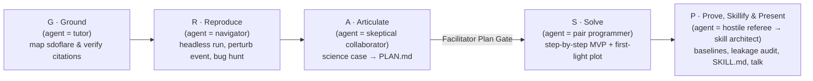

# Heliophysics Toolkit Workshop — Methodology & Facilitator Guide

> [!IMPORTANT]
> **About the worked examples (`sdoflare`):** Throughout this guide and the companion **Participant Handouts** and **Developer Guide**, all concrete examples, prompts, bug-hunt scenarios, backup cases, skill-creation tasks, and verification checks use an **imaginary Python package called `sdoflare`** — a hypothetical toolkit for preprocessing full-disk **SDO/AIA** (EUV) and **SDO/HMI** (magnetogram) images and running **operational solar flare prediction models** evaluated against the **GOES XRS** flare catalog.
>
> `sdoflare` is an **illustrative stand-in** so you can see exactly how abstract workshop mechanics translate into domain-specific tasks, prompts, and facilitator interventions. When adapting this blueprint to your real toolkit, replace `sdoflare`'s module names, function signatures, notebooks, and domain invariants with your own using the mapping table in **§2**.

---

## 1. Design goals and what "success" means

| Goal | Evidence at the end of the 1.5-day workshop |
|---|---|
| Scientists **understand** the toolkit (data model, APIs, physical assumptions, sharp edges) | They answer "exit ticket" questions *without* the agent (e.g., why `aia_l1_to_l15` does not correct sensitivity degradation, or why splits use a 27-day Carrington buffer); their personal cheat sheet cites real `file:line` numbers |
| Scientists **solve** a slice of their own science case | A working, reproducible notebook + `.py` helper module (MVP) tested against `PersistenceBaseline` and `ClimatologyBaseline`, with a known-event check (e.g., Sep 2017 AR 12673) |
| Scientists use coding agents **in a directed way**, not blindly | They follow the plan → implement → verify loop, keep reusable logic in `.py` files, and present at least one agent error they caught in their final talk |
| Scientists **encapsulate their workflow as a reusable Agent Skill** for other science users | A validated `skills/<skill-name>/SKILL.md` + parameterized CLI script (`scripts/<skill_cli>.py`) that a pod-mate (or fresh agent session) successfully invokes in a single natural-language prompt on a perturbed date range or event |
| Organizers get **structured toolkit feedback + a community skill catalog** | A harvested set of GitHub-ready toolkit issues **plus** 12–20 domain-validated agent skills ready to ship with the next release of the toolkit |

### Why "directed" agent use — and finishing by creating a Skill — works
Left undirected ("build me a flare forecaster from these SDO images"), a coding agent will produce a plausible notebook in five minutes that:
- bypasses your toolkit to write raw `astropy.io.fits` / `sunpy` boilerplate,
- divides AIA images by `EXPTIME` twice (or forgets multi-year EUV channel degradation),
- uses `train_test_split(shuffle=True)` on 6-hour full-disk cadences so frames of the *same* active region sit in both train and test, yielding an unphysical $\text{TSS} > 0.90$, or
- reports 96% "accuracy" on an M-flare dataset with a 4% base rate.

The methodology prevents this with three mechanisms:
1. **The GRASP delegation ladder** — the agent's role expands (*tutor → navigator → skeptical collaborator → pair programmer → hostile referee & skill architect*) only as participants demonstrate understanding.
2. **Grounding & verification rituals** — every prompt points at `@src/...` and `@notebooks/...`; every claim requires a `file:line` citation; every scientific output requires a physical sanity check.
3. **Human gates & skill distillation** — a facilitator **Plan Gate** before modeling, a **90-minute First-Light plot** checkpoint, **no-agent exit tickets**, a **Reusable Skill (`X3`–`X4`)** where participants encode their workflow and hard-won domain guardrails for other scientists, and a mandatory **"Agent Story + Skill Demo" slide** in the final presentation.

---

## 2. Reference illustrative toolkit (`sdoflare`) and how to map yours

All concrete examples below assume this imaginary `sdoflare` package:

| Imaginary `sdoflare` component | Concrete examples in this guide | What you substitute for your real toolkit |
|---|---|---|
| `sdoflare.io` | `load_aia_map()`, `load_hmi_los()`, `load_goes_xrs()`, `load_flare_catalog()`, `SDOTimeIndex` | Your data loaders, catalog readers, and time-index classes |
| `sdoflare.prep` | `aia_l1_to_l15()` (pointing, roll, $0.6''/\text{pix}$), `correct_aia_degradation()` ($\text{DN}\,\text{s}^{-1}\,\text{pix}^{-1}$), `correct_hmi_projection()` ($\mu = \cos\theta$, mask $R/R_\odot > 0.95$), `coalign_full_disk()`, `scale_channels()` | Your calibration, coordinate registration, quality masking, and tensor assembly functions |
| `sdoflare.labels` | `label_flare_window()` (24h $\ge\text{M1.0}$ binary or peak GOES flux, flagging SDO eclipses), `carrington_split(buffer_days=27)` | Your target builders, event matchers, and domain-safe train/val/test splitters |
| `sdoflare.models` | `FullDiskFlareNet`, `extract_disk_embeddings()`, `LinearProbeForecaster`, `PersistenceBaseline`, `ClimatologyBaseline`, `attribute_disk_regions()` | Your pretrained models, feature extractors, fine-tuning wrappers, and baselines |
| `sdoflare.eval` | `compute_tss_hss()`, `find_optimal_tss_threshold()`, `brier_skill_score()`, `block_bootstrap_metric()`, `reliability_diagram()`, `plot_event_timeline()` | Your skill scores, diagnostic plots, and uncertainty calculators |
| `notebooks/01`–`05` | `01_sdo_ingest_and_l15_prep` → `05_evaluation_attribution_and_events` | Your tutorial notebooks, indexed by *science question → notebook → functions* |
| `skills/` | Pre-installed `sdo-ar-event-attribution` + participant-built `sdo-euv-channel-ablation`, `sdo-limb-foreshortening-audit`, `sdo-preflare-flux-probe` | 1 reference skill built by the developer + the skills created by participants in Module 6 |

---

## 3. The GRASP ladder



| Rung | Agent role | Scientist role | Time share |
|---|---|---|---|
| **G**round | Explains `sdoflare` architecture, maps notebooks, quizzes user. **Read-only** | Learner; opens `file:line` citations to calibrate trust | ~10% |
| **R**eproduce | Runs notebooks via `papermill`, plans 1-variable perturbations, hunts bugs | Operator; explains physical meaning of changes & catches domain bugs | ~10% |
| **A**rticulate | Challenges scope, maps steps to `sdoflare` APIs, flags leakage risks. **No code** | Principal Investigator; owns the question, metric, baseline, and cut list | ~10% |
| **S**olve | Plans → implements one `.py` module step → runs `pytest` → explains back | Driver & code reviewer; checks physical units, scales, and first-light plot | ~40% |
| **P**rove, Skillify & Present | Audits for leakage, acts as hostile ApJ referee, then packages validated `.py` code into a reusable `SKILL.md` + CLI script | Defender & author; runs cheap referee test, verifies pod-mate's skill, presents without the agent | ~30% |

---

## 4. The Agent Operating Contract & environment setup

Participants receive the one-page **Agent Operating Contract** (Handout `H0`):
1. **Ground every ask** (`@notebooks/...`, `@src/sdoflare/...`) and verify citations.
2. **Plan before code** (wait for explicit human approval).
3. **One step at a time** (small change → run → inspect).
4. **Toolkit first** (use `sdoflare`; never let the agent reinvent FITS loaders or TSS metrics).
5. **Verify before trust** (units/range assertion + known-event check + baseline).
6. **You own the physics** (data choices, metrics, interpretation).
7. **Log the misses — then bake them into a reusable Skill** in `ERROR_LOG.md` + **3-strikes rule** (after 3 failed fixes, run stuck prompt `S5`).

### Why keeping reusable code in `work/<name>/src/*.py` pays off twice
In Module 4 (`S1`), participants put their core functions in `work/<name>/src/*.py` and keep notebooks thin. That discipline makes Module 6 (`X3 · Distill into a Skill`) effortless: the coding agent wraps `work/<name>/src/*.py` into `skills/<skill-name>/scripts/<skill_cli>.py` and populates `## Common Mistakes` in `SKILL.md` directly from `work/<name>/ERROR_LOG.md`.

---

## 5. Schedule at a glance (1.5 days)

Assumes 12–24 scientists in **pods of 3–4** grouped by science theme (e.g., *Pod 1: EUV channel physics & calibration; Pod 2: Magnetogram geometry & limb events; Pod 3: Transfer learning, embeddings & custom horizons*), with 1 facilitator per ~8 participants.

### Day 1 (09:00–17:30)

| Time | Block | Agent role | Facilitator focus |
|---|---|---|---|
| 09:00–09:30 | **Kickoff & Live Calibration Demo** (script in §6.0) | — | Show 1 impressive agent win and 1 seductive SDO/flare failure |
| 09:30–10:00 | **`sdoflare` in 30 minutes**: data model, L1→L1.5→cube flow, model heads, sharp edges, reference skill | — | Point to `notebooks/README.md`, `docs/CHEATSHEET.md`, and `skills/sdo-ar-event-attribution/` |
| 10:00–10:30 | **M0 · Setup & first contact** | — | Get everyone green on `check_setup.py` and `pytest` |
| 10:30–11:30 | **M1 · GROUND** (`G1`–`G4`: map, walkthrough, quiz, cheat sheet) | Tutor | Ensure participants actually open 3 `file:line` citations |
| 11:30–11:45 | Break | | |
| 11:45–12:45 | **M2 · REPRODUCE** (`R1`–`R3`: headless run, event perturbation, SDO bug hunt) | Navigator | Debrief the 3 bug-hunt notebooks (§6.2 answer key) |
| 12:45–13:45 | Lunch | | Stage any missing catalog/event slice in `data/` |
| 13:45–14:45 | **M3 · ARTICULATE** (`A1`–`A3`: `PLAN.md`, pod peer review, **Plan Gate**) | Skeptical collaborator | Sign off on `PLAN.md` (including target skill name); assign backup cases if needed |
| 14:45–16:45 | **M4 · SOLVE, sprint 1** (`S1`–`S5`; **First-Light checkpoint at 16:15**) | Pair programmer | Enforce `.py` + test loop; pair with anyone missing First Light |
| 16:45–17:15 | **Pod standups**: 2-min First-Light demo + "best agent error of the day" | — | Normalize catching agent mistakes |
| 17:15–17:30 | **Wrap Day 1**: generate `HANDOFF.md` (`S6`) and `git commit` | — | |

### Day 2 (09:00–13:00)

| Time | Block | Agent role | Facilitator focus |
|---|---|---|---|
| 09:00–09:15 | **Re-entry**: new agent session reads `PLAN.md` + `HANDOFF.md`; cut scope | — | Force scope cuts on anyone behind schedule |
| 09:15–10:40 | **M5 · SOLVE sprint 2 (40m) + PROVE (45m)** (`P1`–`P5`) | Pair programmer → Hostile referee | Call **"pencils down on new features" at 09:55**; run leakage audit & baselines |
| 10:40–10:55 | Break | | |
| 10:55–11:40 | **M6 · PACKAGE & SKILLIFY** (`X1`–`X5`: clean `papermill` run, `FINDINGS.md`, **distill `SKILL.md` + CLI (`X3`)**, **pod-swap skill test (`X4`)**, toolkit issues) | Skill architect & editor | Ensure every skill passes `env/validate_skill.py` and is tested in a fresh session |
| 11:40–12:35 | **Lightning talks** (5 min each: Question → Toolkit → Result → Agent Story → **Reusable Skill Demo** + Wishes) | — | Keep time strictly; highlight each new community skill |
| 12:35–13:00 | **Retro & Harvest**: collect `skills/*`, `ERROR_LOG.md`, toolkit issues, post-survey | — | Open PRs adding the cohort's validated skills to the community catalog |

---

## 6. Module-by-module facilitator playbook (with `sdoflare` examples)

### 6.0 Kickoff Calibration Demo script (10 minutes, live on screen)
Run this two-part demo at 09:15 on Day 1 to calibrate trust across the room in 10 minutes:

1. **Part A — What the agent does remarkably well (3 min):**
   - Ask the agent (grounded in `@src/sdoflare/prep.py` and `@notebooks/01_sdo_ingest_and_l15_prep.ipynb`):
     > *"Trace the exact chain of functions and unit conversions from a raw AIA 131 Å Level 1 FITS file and HMI LOS magnetogram to the normalized 4-channel tensor fed into `FullDiskFlareNet`. Cite `file:line` for every step."*
   - Show the audience how fast and accurately it produces the call graph with line numbers.
2. **Part B — How an undirected prompt fails silently and catastrophically (5 min):**
   - Switch to a temporary directory *without* `GEMINI.md` and type an undirected prompt:
     > *"Load the 2014 SDO embeddings in `data/embeddings/sdo_fulldisk_embeddings_6h_2011_2018.zarr`, train a classifier for 24h M-flares, and print the test TSS."*
   - Watch the agent write `train_test_split(X, y, test_size=0.2, random_state=42)` on 6-hour cadence frames and proudly print **`TSS = 0.91`**.
   - Ask the room: *"Why is TSS = 0.91 fake?"* (Because consecutive 6-hour frames of super-active region NOAA AR 12192 sit in both `X_train` and `X_test`, and the 24-hour label windows overlap by 18 hours.)
   - Now run prompt **`P2` (Leakage Audit)** on that exact script and watch the agent catch its own mistake when directed properly.

---

### 6.1 M1 · GROUND (60 min) — agent as tutor
- **What participants do**: run `G1` (map `sdoflare`), `G2` (walk through one notebook), `G3` (5-question interactive quiz), `G4` (personal cheat sheet).
- **What facilitators watch for**:
  - Participants skimming `toolkit_map.md` without opening any source file. Walk up and ask: *"Show me the three `file:line` citations you verified."*
  - Subtle docstring misreads the agent often makes on `sdoflare`:
    - Claiming `aia_l1_to_l15()` corrects instrument degradation (it only does pointing, roll to solar north, and $0.6''/\text{pix}$ plate-scale registration; `correct_aia_degradation()` does exposure normalization and time-dependent sensitivity).
    - Assuming `correct_hmi_projection()` converts $B_{\text{los}}$ into true radial field $B_r$ everywhere (it only divides by $\mu = \cos\theta$ down to $\mu_{\min}=0.2$, which breaks down near the limb).

---

### 6.2 M2 · REPRODUCE (60 min) — agent as navigator & Bug Hunt answer key
- **What participants do**: `R1` (headless `papermill` run of `03_pretrained_fulldisk_flare_forecast.ipynb`), `R2` (perturb one variable, e.g., swap Sep 2017 AR 12673 for Oct 2014 AR 12192 or change 24h $\ge\text{M1.0}$ to 12h $\ge\text{C5.0}$), `R3` (Bug Hunt on 3 broken notebooks).

#### Facilitator Private Answer Key for `R3` (Bug Hunt)

| Broken notebook | Symptom | The planted bug(s) | What the agent usually does on first pass (`R3`) | How to debrief with the room |
|---|---|---|---|---|
| `bughunt/bug_A_high_skill.ipynb` | Reports $\text{TSS} = 0.91$, $\text{HSS} = 0.86$ on 24h $\ge\text{M1.0}$ forecasting | **1.** Uses `train_test_split(shuffle=True)` on 1-hour cadence full-disk embeddings instead of `carrington_split(buffer_days=27)`.<br>**2.** Fits `StandardScaler` and tunes the TSS decision threshold on the combined dataset before splitting. | Usually catches the `StandardScaler` / threshold leakage immediately; **often misses** that even a chronological split without a 27-day solar-rotation buffer leaks active regions across the boundary unless nudged. | Emphasize that full-disk images have a **27-day physical autocorrelation clock** (solar rotation) on top of the 24-hour label window. |
| `bughunt/bug_B_cycle_drift.ipynb` | Predicted flare probability drifts downward by 40% from 2011 to 2017 even on similar active regions | **1.** Calls `aia_l1_to_l15()` and manually divides by `meta['EXPTIME']`, **omitting `correct_aia_degradation()`**.<br>**2.** Clips AIA 94 Å at a fixed raw DN ceiling before log-scaling. | Often blames "solar cycle decline in true flare rate" unless told to compare the preprocessing cells line-by-line against `@notebooks/01_sdo_ingest_and_l15_prep.ipynb`. | Show how instrumental degradation masquerades as a physical solar-cycle effect, and why grounding the prompt against `@notebooks/01_...` immediately exposes the missing call. |
| `bughunt/bug_C_quiet_limb.ipynb` | Misses East-limb M/X flares and mis-attributes flares by ~$90^\circ$ heliographic longitude | **1.** Stacks AIA and HMI arrays by file list index instead of `coalign_full_disk()` across a 6-hour HMI dropout.<br>**2.** Parses file modification timestamps (local Mountain Time) as UTC (`DATE-OBS`).<br>**3.** Divides HMI $B_{\text{los}}$ by $\mu = \cos\theta$ all the way to $\mu = 0$ without `R/R_sun <= 0.95` masking. | Spots the `cos(theta)` division-by-zero warning quickly; frequently **misses** the index-stacking timestamp drift and local-vs-UTC timestamp bug until asked to inspect time deltas. | Reinforce the rule: never align multi-instrument SDO series by array index; always check `max(|t_aia - t_hmi|)` and limb NaN masks. |

---

### 6.3 M3 · ARTICULATE (60 min) — Plan Gate coaching & Backup Cases
- **What participants do**: use `A1` (skeptical collaborator prompt, **no code allowed**) to write `work/<name>/PLAN.md` (including the candidate skill name and configurable parameters they plan to expose in M6), peer-review in pods (`A2`), and get facilitator sign-off at the **Plan Gate (`A3`)**.

#### How facilitators coach common scope traps at the Plan Gate

| What the scientist proposes | Why it will fail in 5 hours | How the facilitator re-scopes the MVP (keep the original as Stretch) |
|---|---|---|
| *"I want to retrain `FullDiskFlareNet` end-to-end on 5 years of $4096\times 4096$ 12-minute AIA + HMI FITS files with a new loss function."* | I/O and GPU training will take days, not hours. | **MVP**: Freeze the `FullDiskFlareNet` backbone; use the precomputed $512\times 512$ cubes or disk embeddings in `data/embeddings/` and train `LinearProbeForecaster` / a 2-layer head with your custom loss (notebook `04`). |
| *"I want to predict CME geoeffectiveness ($D_{\text{st}} < -100\,\text{nT}$ at L1) from SDO full-disk images alone."* | Only ~15–20 major storms exist in the sample and $B_z$ at L1 depends on interplanetary evolution not in `sdoflare`. | **MVP**: Predict whether an M/X flare in `sdoflare` is **eruptive vs confined** (using the pre-staged `data/catalogs/goes_cme_association_catalog.parquet`), or restrict to halo-CME association within 24h. |
| *"I want to test 8 different ViT architectures on flare prediction."* | Pure ML bake-off; teaches nothing about `sdoflare`'s physical preprocessing or validation. | **MVP**: One model (`FullDiskFlareNet` or `LinearProbeForecaster`), one physical hypothesis (e.g., channel ablation, limb dependence, or pre-flare horizon), validated thoroughly against `PersistenceBaseline`. |

#### Three ready-to-go Backup Science Cases (assign to anyone without a viable case by 14:15)
All data for these three cases is pre-staged in `data/`:
1. **Backup Case α (EUV Hot-Channel Ablation & Degradation Sensitivity → Skill `sdo-euv-channel-ablation`):** Quantify how much adding AIA 94 Å + 131 Å to HMI $B_{\text{los}}$ + AIA 171 Å changes 24h $\ge\text{M1.0}$ TSS and BSS across 2014–2017, and measure the skill penalty when `correct_aia_degradation()` is turned off.
2. **Backup Case β (Center-to-Limb Foreshortening Bias → Skill `sdo-limb-foreshortening-audit`):** Stratify `FullDiskFlareNet` skill by the heliographic longitude of the dominant flaring NOAA AR ($|\lambda| \le 30^\circ$, $30^\circ < |\lambda| \le 60^\circ$, $|\lambda| > 60^\circ$) and test whether adding off-limb EUV ring features ($0.95 < R/R_\odot < 1.15$ in AIA 193/211 Å) improves limb recall.
3. **Backup Case γ (Flare-in-Progress Contamination vs True Pre-Flare Skill → Skill `sdo-preflare-flux-probe`):** Evaluate how much of the apparent 24h $\ge\text{M1.0}$ skill at 1h, 6h, 12h, and 24h horizons comes from timestamps where GOES 1–8 Å flux at issue time $t_0$ is already elevated ($\ge\text{C2.0}$), and retrain a probe exclusively on "quiet-background pre-flare" timestamps.

---

### 6.4 M4 · SOLVE, sprint 1 (120 min) — First-Light checkpoint
- **90-minute checkpoint (16:15 on Day 1)**: Every participant must have `work/<name>/figures/first_light.png` on screen and pass a 60-second facilitator visual check:
  1. Are physical units on the axes/colorbars ($\text{G}$ for HMI, $\text{DN}\,\text{s}^{-1}\,\text{pix}^{-1}$ for AIA, $\text{W}\,\text{m}^{-2}$ for GOES)?
  2. Are values in a physically sane range (on-disk median AIA 171 is $\sim 10^2\,\text{DN}\,\text{s}^{-1}\,\text{pix}^{-1}$; HMI $B_{\text{los}}$ within $\pm 4000\,\text{G}$ with off-limb masked)?
  3. Are timestamp (UTC), instrument/channels, and coordinate frame in the title?
- **If a participant does not have First Light at 16:15**: pair a facilitator with them immediately, cut their plan using the Cut List in `PLAN.md`, and switch them to Tier 1 embeddings (`data/embeddings/`) so they are unblocked before Day 1 ends.

---

### 6.5 M5 · SOLVE sprint 2 + PROVE (85 min) — Hostile Referee & Leakage Audit
- **At 09:55 on Day 2 (40 min into M5)**, announce to the room:
  > *"Pencils down on new model features. Everyone switches the agent to Hostile Referee mode (`P1`–`P5`). In the final rubric, a simple model with a clean baseline, leakage audit, Carrington-block error bars, and a reusable skill scores higher than a complex model without validation."*
- **Three domain checks facilitators verify during M5**:
  1. **Threshold discipline**: Did they call `find_optimal_tss_threshold` on the *validation* split and freeze it for the *test* split?
  2. **Flare-in-progress check**: For anyone using AIA 94/131 Å or GOES background features, did they check how much skill drops when ongoing flares at $t_0$ ($\text{GOES flux}(t_0) \ge \text{C5.0}$) are excluded?
  3. **Block bootstrap**: Are confidence intervals computed via `block_bootstrap_metric` over **Carrington rotations** rather than individual 6-hour frames?

---

### 6.6 M6 · PACKAGE, SKILLIFY & PRESENT (45 min prep + 55 min talks) — agent as Skill Architect

In M6, participants use their coding agent to turn their validated science workflow into a **reusable Agent Skill** (`skills/<skill-name>/SKILL.md` + `scripts/<skill_cli>.py`) following `X3` and test it via `X4`.

#### How the 2-step Skill Distillation (`X3` + `X4`) works
1. **Phase 1 — Brainstorm & Design (`X3 Step 1`, 8 min, no files written):**
   - Participant points the agent at `@skills/sdo-ar-event-attribution/SKILL.md` (the reference skill), `@templates/SKILL_TEMPLATE.md`, `@work/<name>/src/`, and `@work/<name>/ERROR_LOG.md`.
   - The agent proposes: (a) skill name & trigger description (*when to use* vs *when not to use*), (b) which parameters are exposed as CLI flags (`--start-date`, `--end-date`, `--channels`, `--horizon-hours`, `--min-flare-class`, `--output-dir`) vs which domain guardrails are locked in (`carrington_split`, `correct_aia_degradation`, validation-only threshold), and (c) which agent mistakes from `ERROR_LOG.md` go into `## Common Mistakes`.
   - Participant reviews and approves the design.
2. **Phase 2 — Implement & Validate (`X3 Step 2`, 12 min):**
   - Agent creates `skills/<skill-name>/SKILL.md` and `skills/<skill-name>/scripts/<skill_cli>.py` (wrapping the functions already written in `work/<name>/src/*.py`), then runs `python env/validate_skill.py skills/<skill-name>`.
   - `validate_skill.py` checks the YAML frontmatter, required sections, verifies `scripts/<skill_cli>.py --help` exits `0`, and symlinks the skill into `.gemini/skills/<skill-name>`, `.claude/skills/<skill-name>`, and `.agents/skills/<skill-name>`.
3. **Phase 3 — Fresh-Session / Pod-Swap Verification (`X4`, 10 min):**
   - Participants open a **fresh agent session** (or swap with a pod-mate) and issue a single natural-language prompt with slightly modified parameters (e.g., *"Use the `sdo-euv-channel-ablation` skill to evaluate 12h >=C5.0 forecasting on 2015–2016 cubes and save outputs to `work/elena/runs/verify/`"*).
   - The skill is verified when the fresh agent discovers `SKILL.md`, invokes `scripts/<skill_cli>.py` with the right flags, and writes the output table and figure without manual intervention.

#### Common failure modes when agents generate skills (and how facilitators intervene)

| What the agent does wrong during `X3` | Why it breaks reuse for other scientists | Facilitator fix |
|---|---|---|
| **Hardcodes the participant's dates, event ID, or `work/<name>` path inside the skill** | Another scientist asking about 2016 or AR 12192 silently gets results for 2014 or crashes | Require all dates, channel lists, thresholds, and `--output-dir` to be required CLI flags in `scripts/<skill_cli>.py` (`env/validate_skill.py` checks this) |
| **Writes a prose-only `SKILL.md` with no executable script in `scripts/`** | Future agents will re-invent the code from scratch every time the skill is triggered, repeating the same bugs | Enforce the rule: any workflow that processes SDO data or computes metrics **must** wrap `work/<name>/src/` in an `argparse` CLI script |
| **Dumps thousands of lines of array/table output to stdout** | Blows up the calling agent's context window | Require the CLI script to write `metrics.json`, `comparison_table.md`, and `.png` plots to `--output-dir` and print only a short summary + file paths |
| **Writes a vague YAML `description:` (e.g. `"Does solar flare prediction"` )** | Either triggers on every prompt or never triggers | Require the description to state the specific physical mechanism/question, **Use when...**, and **Do not use for...** |
| **Omits the `ERROR_LOG.md` lessons** | Other users' agents fall into the exact same traps | Check that `## Common Mistakes` in `SKILL.md` contains at least 2 concrete entries copied from the participant's `ERROR_LOG.md` |

---

## 7. Pre-workshop preparation checklist (for the `sdoflare` example)

### 7.1 Pre-staged `data/` manifest (zero network access during the workshop)

```text
data/
├── README.md                                      # Exact schemas, units, time ranges, and known eclipse gaps
├── catalogs/
│   ├── goes_xrs_1min_2011_2019.parquet            # 1-min GOES 1–8 Å & 0.5–4 Å flux (W m^-2, UTC)
│   ├── goes_flare_catalog_with_ar_locations.parquet # Start/peak/end, class, NOAA AR, heliographic (lat, lon)
│   └── sdo_eclipse_and_quality_flags.parquet      # Timestamps with eclipse/calibration roll bitmasks
├── embeddings/                                    # Tier 1 (fastest, runs on CPU in seconds)
│   └── sdo_fulldisk_embeddings_6h_2011_2018.zarr  # Precomputed FullDiskFlareNet 512-d embeddings + channel stats
├── cubes_512/                                     # Tier 2 (medium, 6-hour cadence 512x512 L1.5 co-aligned cubes)
│   └── sdo_aia94_131_171_193_211_hmi_2014_2017.zarr
└── sdo_events/                                    # Tier 3 (full-resolution L1 & L1.5 FITS for case studies)
    ├── ar12192_201410/                            # Oct 18–28, 2014 (6 X-flares, confined giant AR)
    ├── ar12673_201709/                            # Sep 4–10, 2017 (X2.2, X9.3 disk + X8.2 West limb)
    └── quiet_201905/                              # 7-day solar-minimum negative-control interval
```

### 7.2 Pre-workshop Agent Smoke Test (run 1 week before the event)
Start a fresh coding agent in the repo root (with `GEMINI.md` / `AGENTS.md` in place) and run these **10 canonical prompts**. Require **$\ge 8/10$ right with exact `file:line` citations**:

1. *"Which `sdoflare` function converts AIA Level 1 FITS to Level 1.5, and does it normalize by `EXPTIME` or correct channel degradation? Cite `file:line`."*
2. *"How does `correct_hmi_projection()` treat pixels with $\mu < 0.2$ and $R/R_\odot > 0.95$? Cite `file:line`."*
3. *"What channel order, units, and intensity scaling does `FullDiskFlareNet` require? Cite `src/sdoflare/models.py` and the notebook cell that builds the tensor."*
4. *"How do I split a 2014–2017 SDO dataset into train, validation, and test without leaking active regions across boundaries? Show the exact `sdoflare` call."*
5. *"Use the pre-installed `sdo-ar-event-attribution` skill in `skills/` to run active-region attribution on the Sep 6, 2017 06:00 UTC event in `data/sdo_events/ar12673_201709/`."*
6. *"How does `label_flare_window()` behave when an SDO eclipse gap falls inside `[t0, t0+24h]`? Cite `file:line`."*
7. *"Run `notebooks/03_pretrained_fulldisk_flare_forecast.ipynb` via `papermill` and report the test TSS, HSS, and BSS against `PersistenceBaseline`."*
8. *"Find the domain bugs in `bughunt/bug_A_high_skill.ipynb` and `bughunt/bug_B_cycle_drift.ipynb`."*
9. *"Why is raw accuracy invalid for 24h $\ge\text{M1.0}$ evaluation, and how does `compute_tss_hss()` require the probability threshold to be chosen?"*
10. *"Add a Carrington-rotation block bootstrap 95% confidence interval to a test TSS score using `sdoflare.eval.block_bootstrap_metric`."*

---

## 8. Assessment rubric & pre/post survey (shared with participants on Day 1)

### Pre/post self-assessment (1–5 Likert)
1. I can find the `sdoflare` functions I need and verify their physical assumptions without help.
2. I can adapt one of the toolkit notebooks to a new solar event, channel set, or forecast horizon.
3. I can tell when a coding agent's heliophysics or statistical output is wrong.
4. I know how to direct a coding agent to use a specific scientific library rather than reinventing it.
5. I can validate a flare forecast/analysis against baselines and audit it for temporal/rotation leakage.
6. **I can distill a validated scientific workflow into a reusable Agent Skill (`SKILL.md` + CLI script) that another scientist can run on new data.**

### Final project rubric (0–2 each)

| Criterion | 0 (Incomplete) | 1 (Solid) | 2 (Exemplary) |
|---|---|---|---|
| **1. Question & Scoping** | Unscoped or unachievable with staged SDO data | Clear input → output → metric question; MVP completed | Falsifiable physical/operational hypothesis with clean MVP + cut list |
| **2. `sdoflare` Usage** | Agent rewrote custom loaders/metrics or bypassed `sdoflare` | Uses `sdoflare.io/prep/models/eval` properly; code in `.py` | Respects all SDO conventions (L1.5, degradation, $\mu$-mask, units) + logs toolkit gaps |
| **3. Validation & Physics** | Single metric without baseline or leakage check | Compared against `PersistenceBaseline` + chronological split + 1 sanity test | `carrington_split` + leakage audit (`P2`) + known-event check (`P3`) + hostile-referee test (`P4`) + block-bootstrap CI (`P5`) |
| **4. Directed Agent Literacy** | Accepted agent code blindly; cannot explain assumptions | Used plan → code → test loop; logged $\ge 1$ error in `ERROR_LOG.md` | Caught a subtle domain/statistical agent error, verified citations, can defend every line |
| **5. Reproducibility & Reusable Skill** | Notebook fails on restart-and-run-all; no skill created | `papermill` run passes; `FINDINGS.md` written; draft `SKILL.md` exists | Clean `papermill` run + **`skills/<name>/SKILL.md` & CLI script passes `validate_skill.py` and succeeds in a fresh-session / pod-mate test (`X4`)** |

---

## 9. Common workshop failure modes and facilitator interventions

| Failure mode | Early warning sign | Facilitator intervention |
|---|---|---|
| **Agent hallucinates `sdoflare` kwargs or function names** | `AttributeError` / `TypeError` loops | Have participant run `python -c "import sdoflare.prep as p; help(p)"` and paste the signature; check if `GEMINI.md` was loaded |
| **Agent writes raw `sunpy` / `astropy` boilerplate instead of calling `sdoflare`** | 100+ lines of new code in a notebook cell | Point to Rule 4 ("Toolkit first"): *"Delete the cell and ask the agent to search `src/sdoflare/` for the existing function"* |
| **Double `EXPTIME` division or missing AIA degradation** | First-Light AIA intensities look off by $\sim 2\times$ or drift across years | Run Sanity Check `S3` on disk-integrated median EUV flux ($10^1\text{–}10^3\,\text{DN}\,\text{s}^{-1}\,\text{pix}^{-1}$) |
| **Suspiciously high flare skill ($\text{TSS} > 0.85$)** | Participant is excited about an "amazing new model" | Run Leakage Audit `P2` immediately: look for shuffled splits, missing 27-day Carrington buffer, test-set threshold tuning, or flare-in-progress EUV contamination at $t_0$ |
| **Generated `SKILL.md` (`X3`) fails when tested by a pod-mate (`X4`)** | Hardcoded paths/dates or missing CLI flags | Have participant run `python env/validate_skill.py skills/<name>` and test `scripts/<skill_cli>.py --help` before re-running `X4` |
| **Compute bottleneck on full-disk images** | Cell takes $> 3$ minutes to run | Switch participant from Tier 3/Tier 2 images to Tier 1 (`data/embeddings/`) for model iteration, and run full images only on the 2 benchmark events (`ar12192`, `ar12673`) |

---

## 10. After the workshop: harvesting the Community Skill Catalog
1. Collect from every participant branch: `work/<name>/FINDINGS.md`, `HANDOFF.md`, `ERROR_LOG.md`, toolkit issues (`X5`), and their validated skill folder `skills/<skill-name>/`.
2. Run `python env/validate_skill.py skills/<skill-name>` across all submitted skills and merge the passing ones into the main repository's `skills/` directory with an index table in `skills/README.md`.
3. Every future scientist who clones `<toolkit>` (and starts Gemini CLI, Claude Code, or Codex) now inherits a library of peer-tested heliophysics skills created by domain experts during the workshop.

