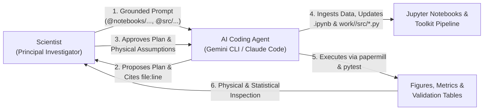

# Workshop Preparation Guide for Project Developers

> [!IMPORTANT]
> **Transitioning from the `sdoflare` Blueprint to Your Actual Project:**
> The existing guides in this repository ([`workshop-basic/`](./workshop-basic/) and [`workshop-advanced/`](./workshop-advanced/)) use a **fictitious reference package named `sdoflare`** (SDO/AIA + HMI solar flare forecasting) so you can see concrete examples of every docstring, notebook index, planted bug, prompt card, and Agent Skill.
>
> **Your task this week** is to replace `sdoflare` with **your actual scientific Python toolkit and datasets**, organizing the notebooks, offline data tiers, scientific goals, and participant prompt guide required to run the live workshop.

---

## 1. Introduction: Overall Mechanics of the Workshop

### 1.1 The Core Paradigm: Prompt-Driven Jupyter Notebooks with AI Coding Agents

This is a **1.5-day hands-on scientific computing workshop** built around **Jupyter Notebooks (`.ipynb`)** and **AI-assisted coding agents** (e.g., Gemini CLI, Claude Code, Codex, Cursor).

Unlike a traditional tutorial where participants passively press `Shift+Enter` on pre-written cells—or a traditional hackathon where participants spend hours debugging raw matplotlib/astropy boilerplate by hand—this workshop introduces an **agent-mediated scientific workflow**:

> **Participants do not manually write or edit large blocks of code inside the notebooks.** Instead, they act as **Principal Investigators and Scientific Directors**, issuing grounded natural-language prompts to a coding agent to:
> 1. **Import and ingest data** from pre-staged offline catalogs and arrays using your toolkit's official loaders,
> 2. **Modify, parameterize, and extend Jupyter notebooks** (and companion `.py` helper modules) to test new scientific hypotheses, events, or parameter regimes,
> 3. **Execute notebooks headlessly** (via `papermill` or notebook execution tools) and run automated physical sanity checks (`pytest`), and
> 4. **Analyze, validate, and critique the scientific results** against domain baselines, audit for subtle physical/statistical leakage, and package their validated workflow into a reusable **Agent Skill**.



### 1.2 Why This Mechanics Changes How Developers Must Prepare Notebooks

When humans read a messy notebook, they mentally fill in missing units, implicit coordinate frames, or undocumented globals. **When a coding agent reads a messy notebook, it hallucinates.** Left undirected or given monolithic 300-line notebook cells, a coding agent will:
- Bypass your toolkit completely and write raw `numpy` / `scipy` / `astropy` / `sunpy` boilerplate from scratch,
- Violate domain invariants silently (e.g., double-normalizing exposure time, mixing coordinate frames, interpolating across instrument dropouts, or shuffling temporally autocorrelated time series into train and test splits),
- Corrupt `.ipynb` JSON when trying to edit massive cells inline.

To make the agent-mediated notebook mechanics work reliably across 15–25 participants, **your workshop repository must be engineered for both human scientists and coding agents**:
1. **Thin, modular notebooks (`notebooks/01_...` to `05_...`)**: Every cell is short ($\le 25$ lines), calls high-level functions from `src/<your_toolkit>/`, and starts with a `papermill`-compatible `"parameters"` cell.
2. **Helper logic extracted to `.py` files**: For custom participant analyses in Module 4, the agent writes reusable functions into `work/<name>/src/*.py` with unit tests in `work/<name>/tests/`, and updates the participant's notebook to import and plot those functions cleanly.
3. **Explicit domain context (`GEMINI.md` / `AGENTS.md` / `CLAUDE.md`)**: A concise ($\le 150$-line) root instruction file loaded automatically by the coding agent that enforces *Toolkit First*, *Plan Before Code*, *Cite `file:line`*, and your toolkit's non-negotiable physical/statistical conventions.
4. **Loud runtime guardrails**: Toolkit functions raise clear `ValueError` exceptions whenever an agent passes wrong units, uncalibrated data levels, naive timestamps, or leaky train/test splits.
5. **100% offline pre-staged data (`data/`)**: Zero live downloads during the workshop; data is organized into fast CPU embeddings/catalogs (Tier 1), medium downsampled cubes/arrays (Tier 2), and full-resolution benchmark event slices (Tier 3).

---

## 2. Structure of the Workshop: Modules `M0` to `M6` (The GRASP Ladder)

The 1.5-day curriculum follows the **GRASP** progression (**G**round $\to$ **R**eproduce $\to$ **A**rticulate $\to$ **S**olve $\to$ **P**rove & Skillify). Across modules `M0`–`M6`, the coding agent's autonomy expands only as the participant demonstrates mastery of the toolkit and its physical assumptions.

| Module | Time | Agent Role | Participant Role | How Participants Use the Agent with Notebooks | Key Deliverable / Gate |
|---|---|---|---|---|---|
| **M0 · Setup & First Contact** | Day 1<br/>30 min | **Environment Checker** | Operator | Prompt agent to summarize rules loaded from `GEMINI.md`, list the notebooks in `@notebooks/README.md`, and run `pytest -q tests/` + `env/check_setup.py`. | Green setup check; `work/<name>/` sandbox initialized. |
| **M1 · GROUND** | Day 1<br/>60 min | **Tutor**<br/>*(Read-Only)* | Learner & Fact-Checker | Prompt agent to map `@src/<toolkit>/` and `@notebooks/README.md` (`G1`), explain a tutorial notebook cell-by-cell (`G2`), quiz the participant on physical assumptions (`G3`), and assemble a personal cheat sheet of notebook snippets (`G4`). | `work/<name>/notes/toolkit_map.md` & `my_cheatsheet.md` with **3 manually verified `file:line` citations**. |
| **M2 · REPRODUCE & BUG HUNT** | Day 1<br/>60 min | **Navigator** | Experimentalist & Auditor | Prompt agent to execute a tutorial notebook headlessly via `papermill` (`R1`), create and run a modified notebook variant on a new event/parameter (`R2`), and inspect 3 broken notebooks (`bughunt/bug_A..C.ipynb`) to diagnose silent scientific bugs (`R3`). | Executed variant notebook `work/<name>/<variant>.ipynb` + physical explanation of changes + Bug Hunt debrief. |
| **M3 · ARTICULATE** | Day 1<br/>60 min | **Skeptical Collaborator**<br/>*(No Code Allowed)* | Principal Investigator | Prompt agent to challenge scope and draft a 5-hour Minimum Viable Science plan (`PLAN.md`) mapping every step to existing tutorial notebooks, toolkit functions, and pre-staged `data/` (`A1`–`A2`). | **`PLAN.md` signed off by a facilitator at the Plan Gate (`A3`)** before any custom code is written. |
| **M4 · SOLVE (Sprint 1)** | Day 1<br/>120 min | **Pair Programmer** | Scientific Director & Code Reviewer | Prompt agent in a strict *Plan $\to$ Approve $\to$ Update `.py` & `.ipynb` $\to$ Run $\to$ Sanity-Check* loop (`S1`–`S4`) to ingest data, build the analysis notebook, run physical unit/range assertions, and generate a First-Light plot. End Day 1 by generating `HANDOFF.md` (`S6`). | **90-Minute First-Light Plot (`figures/first_light.png`)** passing facilitator visual check + passing `test_sanity.py` + `HANDOFF.md`. |
| **M5 · SOLVE (Sprint 2) + PROVE** | Day 2<br/>85 min | **Hostile Journal Referee** | Defender & Validator | Finish MVP notebook (40 min), then switch agent to Hostile Referee mode (45 min): prompt agent to run domain baselines (`P1`), audit the notebook/code for data leakage & circularity (`P2`), run benchmark event & negative-control checks (`P3`), critique the findings as a hostile referee (`P4`), and add block-bootstrapped error bars (`P5`). | `results_table.md` (with baselines & CIs), `figures/main_result.png`, leakage audit report, and 1 executed referee test. |
| **M6 · PACKAGE, SKILLIFY & PRESENT** | Day 2<br/>100 min | **Skill Architect & Technical Editor** | Author & Presenter | Prompt agent to clean the notebook and verify a fresh `papermill` run (`X1`), generate a 1-page `FINDINGS.md` (`X2`), distill the notebook pipeline + `ERROR_LOG.md` into a reusable **Agent Skill** (`skills/<name>/SKILL.md` + CLI script) (`X3`), test a pod-mate's skill in a fresh session (`X4`), and file toolkit GitHub issues (`X5`). | Reproducible `final_verified.ipynb`, `FINDINGS.md`, validated `skills/<name>/`, and 5-min lightning talk. |

> [!TIP]
> **Choosing Between the Basic and Advanced Editions:**
> - Follow **[`workshop-basic/`](./workshop-basic/)** if your toolkit is a standard Python package + Jupyter notebooks.
> - Follow **[`workshop-advanced/`](./workshop-advanced/)** if your team also wants to expose domain **MCP Servers** (`FastMCP`) and machine-checkable **Declarative Validation Specifications (`specs/*.json`)** alongside the notebooks.

---

## 3. One-Week Plan to Deliver the Workshop Materials

Below is the structured plan for the development team to design, implement, and verify all workshop materials during the preparation week. It is organized around the **three primary deliverables**—**(3.1) Scientific Goals & Cases**, **(3.2) Workshop Notebooks**, and **(3.3) The Participant Guide & Prompt Catalog**—followed by the **day-by-day execution schedule (3.4)**.

---

### 3.1 Deliverable 1: Scientific Goals & Benchmark Science Cases for Participants

Before writing or refactoring notebooks, the development team must define **what scientific outcomes participants will achieve** and stage the exact offline datasets needed to make those goals achievable within 5 hours of hands-on work.

#### A. Core Scientific & Methodological Goals for Every Participant
By the end of the workshop, every participant must achieve five concrete goals using your toolkit via their coding agent:
1. **Master the Toolkit's Physical Preprocessing & Data Model**: Trace raw/Level-1 inputs through calibration, coordinate registration, quality/gap masking, and feature/tensor assembly—verifying physical units and coordinate frames at every step rather than trusting agent defaults.
2. **Execute & Perturb End-to-End Notebook Workflows**: Run reference notebooks headlessly via `papermill` and systematically evaluate how perturbing a physical parameter (target event, date range, spectral channel, cadence, or threshold) changes the scientific output.
3. **Detect Silent Scientific & Statistical Failure Modes**: Identify subtle domain bugs that produce no Python exceptions—such as temporal/rotational autocorrelation leakage across train/test splits, missing instrument degradation corrections, coordinate projection blow-ups, or threshold tuning on test sets.
4. **Complete a Falsifiable 5-Hour Science Investigation (MVP) with Rigorous Validation**: Formulate a focused science question, implement the analysis via agent-directed notebook + `.py` steps, benchmark against built-in domain baselines (e.g., Persistence and Climatology), validate on a **known positive benchmark event** and a **quiet/negative-control interval**, and compute domain-aware uncertainty intervals.
5. **Publish a Reusable Agent Skill for the Community**: Encapsulate their validated notebook workflow and hard-won domain guardrails into a standalone `skills/<skill-name>/SKILL.md` + parameterized CLI script so any researcher can run the analysis on new dates or events in a single prompt.

#### B. Define 3 Concrete Scientist Personas / Backup Science Cases (`Case α`, `Case β`, `Case γ`)
Not every participant arrives with a well-scoped 5-hour question. Furthermore, all worked prompt examples in the Participant Guide need realistic domain anchors. Developers **must define and pre-stage data for 3 canonical science cases**:

| Case | Archetype | In the `sdoflare` Blueprint | What Developers Must Define for the Actual Project |
|---|---|---|---|
| **Case α** | **Sensor / Channel / Calibration Sensitivity** | *Elena*: Quantifying whether adding hot EUV channels (AIA 94/131 Å) improves 24h $\ge\text{M1.0}$ flare skill across 2014–2017, and measuring the penalty when time-dependent AIA degradation correction is omitted $\to$ Skill `sdo-euv-channel-ablation`. | Define a science question testing **input modality/channel ablation or instrument calibration sensitivity** in your toolkit. Pre-stage the multi-channel/instrument slice in Tier 1 & Tier 2 data. |
| **Case β** | **Geometric / Spatial / Regime Stratification** | *Marco*: Auditing how full-disk flare forecast skill degrades near the solar limb ($|\text{lon}| > 60^\circ, \mu < 0.5$) due to HMI $B_{\text{los}}$ foreshortening, and testing whether off-limb coronal flux recovers recall $\to$ Skill `sdo-limb-foreshortening-audit`. | Define a science question testing **performance across spatial coordinates, viewing geometry, latitude/longitude bins, or physical regimes**, exposing where standard assumptions break down. |
| **Case γ** | **Target Horizon / Physical Mechanism Probing** | *Priya*: Training a fast probe on precomputed embeddings to predict continuous 6h peak X-ray flux around Sep 2017 AR 12673 while filtering out "event-already-in-progress" contamination $\to$ Skill `sdo-preflare-flux-probe`. | Define a science question using **Tier-1 precomputed features/embeddings** to test a custom physical target, lead-time horizon, or confounding-variable filter in seconds on CPU. |

#### C. Stage 3 Benchmark Event Slices & 3 Compute Tiers in `data/`
To support these scientific goals with **zero network access** (`<TOOLKIT>_OFFLINE=1`), developers must populate `data/` with:
- **Tier 1 (`data/embeddings/`, `data/catalogs/`)**: Lightweight tabular catalogs and precomputed model embeddings/features ($< 250\,\text{MB}$) that load and run a complete training/evaluation loop in **$< 5$ seconds on CPU**.
- **Tier 2 (`data/cubes_.../`)**: Downsampled, co-aligned multi-channel arrays/cubes ($1\text{–}4\,\text{GB}$) for testing preprocessing, masking, and model inference in **$< 15$ seconds**.
- **Tier 3 (`data/events/`)**: Full-resolution slices for **3 specific benchmark intervals**:
  1. **Benchmark Event 1 (Primary Active Event)**: Used in Tutorial Notebooks `01` and `05` and sanity check `S3` (analogous to *Sep 2017 AR 12673*).
  2. **Benchmark Event 2 (Perturbation Active Event)**: Used in Module 2 (`R2`) when participants prompt the agent to retarget a notebook to a new event with different physical characteristics (analogous to *Oct 2014 AR 12192*, a confined super-active region).
  3. **Benchmark Event 3 (Quiet / Negative-Control Interval)**: Used in Module 5 (`P3`) to verify that participant models/analyses do not produce chronic false alarms during quiet background conditions (analogous to *May 2019 solar minimum*).

#### D. Developer Mapping Worksheet (`sdoflare` $\to$ Your Toolkit)
As your first task on Day 1 of preparation, fill out this mapping table with your team:

| Concept | Fictitious `sdoflare` Reference | Your Actual Toolkit Equivalent |
|---|---|---|
| **Package import name** | `import sdoflare` (`src/sdoflare/`) | `import <your_pkg>` (`src/<your_pkg>/`) |
| **Data & catalog loaders** | `io.load_aia_map`, `io.load_hmi_los`, `io.load_flare_catalog`, `SDOTimeIndex` | |
| **Calibration & registration** | `prep.aia_l1_to_l15`, `prep.correct_aia_degradation`, `prep.correct_hmi_projection`, `prep.coalign_full_disk` | |
| **Target builder & domain splitter** | `labels.label_flare_window`, `labels.carrington_split(buffer_days=27.0)` | |
| **Models, probes & baselines** | `models.FullDiskFlareNet`, `models.LinearProbeForecaster`, `models.PersistenceBaseline`, `models.ClimatologyBaseline` | |
| **Evaluation & uncertainty** | `eval.compute_tss_hss`, `eval.find_optimal_tss_threshold`, `eval.brier_skill_score`, `eval.block_bootstrap_metric` | |
| **Non-negotiable physical rules** | Single `EXPTIME` division, L1.5 registration, $\mu \ge 0.2$ limb mask, 27-day rotation split buffer, UTC `T_OBS` | |

---

### 3.2 Deliverable 2: List of Notebooks to Be Developed and Organized

Developers must prepare and test **11 notebooks total** (plus 1 index table), divided into three functional groups. Every notebook must be designed so a coding agent can inspect, parameterize, clone, modify, and execute it headlessly via `papermill`.

#### Group 1: The 5 Core Tutorial Notebooks (`notebooks/01_...` to `05_...`)
These five notebooks form the backbone of the workshop. Participants use them in **M1 (Ground)** to learn the toolkit, in **M2 (Reproduce)** to run perturbations, and in **M3–M5 (Articulate, Solve, Prove)** as templates for their own investigation.

| Notebook Filename (Adapt Name to Your Domain) | Pedagogical Role in Workshop | What the Notebook Must Demonstrate | Target Data Tier & Max Runtime |
|---|---|---|---|
| **`notebooks/01_<ingest_and_calibration>.ipynb`**<br/>*(Ref: `01_sdo_ingest_and_l15_prep.ipynb`)* | **Physical Data Ingestion & Calibration** | Loading raw/Level-1 files from `data/events/`, inspecting headers/metadata/units, applying pointing/coordinate registration, instrument degradation/exposure normalization, boundary/quality masking, and plotting calibrated vs. uncalibrated physical quantities. | Tier 3 (`data/events/`)<br/>$\le 20\,\text{s}$ |
| **`notebooks/02_<coalignment_and_labels>.ipynb`**<br/>*(Ref: `02_multichannel_coalignment_and_labels.ipynb`)* | **Multi-Source Alignment, Scaling & Domain Splits** | Co-aligning multiple instruments/channels onto a synchronized spatial/temporal grid, handling observation gaps/eclipses safely, scaling physical channels into model-ready tensors, constructing target labels, and performing a leak-free domain split (e.g., `carrington_split`). | Tier 2 (`data/cubes_.../`) + `catalogs/`<br/>$\le 30\,\text{s}$ |
| **`notebooks/03_<pretrained_model_and_baselines>.ipynb`**<br/>*(Ref: `03_pretrained_fulldisk_flare_forecast.ipynb`)* | **End-to-End Inference & Baseline Benchmarking** | Running your core pretrained model or primary physical algorithm on Tier-2 data, calibrating decision thresholds strictly on the validation split, and comparing domain metrics against `PersistenceBaseline` and `ClimatologyBaseline`. **Used in `R1` headless run.** | Tier 2 (`data/cubes_.../`)<br/>$\le 40\,\text{s}$ |
| **`notebooks/04_<embedding_probing_and_variants>.ipynb`**<br/>*(Ref: `04_embedding_finetune_and_probing.ipynb`)* | **Fast Iteration, Transfer Learning & Parameter Sweeps** | Loading precomputed Tier-1 embeddings/features (`data/embeddings/`) to train a lightweight probe or run a parameter/channel ablation in seconds on CPU, including block-bootstrapped confidence intervals. **Primary template for `R2` and `M4` MVPs.** | Tier 1 (`data/embeddings/`)<br/>$\le 10\,\text{s}$ |
| **`notebooks/05_<event_diagnostics_and_attribution>.ipynb`**<br/>*(Ref: `05_evaluation_attribution_and_events.ipynb`)* | **Event Case Studies, Attribution & Visual Diagnostics** | Running deep-dive diagnostics on a benchmark event (`data/events/`): event timelines, reliability/calibration diagrams, and spatial/physical attribution maps. **Wrapped by the gold-standard reference skill in `skills/`.** | Tier 3 (`data/events/`)<br/>$\le 30\,\text{s}$ |

> **Mandatory Companion Index (`notebooks/README.md`)**:
> Create `notebooks/README.md` containing a single markdown table that maps:
> `| Notebook | Science / Engineering Question Answered | Key Toolkit Functions Demonstrated | Data Tier Used | Headless Runtime |`
> Coding agents read `@notebooks/README.md` first whenever a participant asks *"How do I do X with this toolkit?"*

#### Group 2: The 3 Planted "Bug-Hunt" Notebooks (`bughunt/`)
Used in **Module 2 (`R3`)** to teach participants why they cannot blindly trust code that "runs without errors." Each notebook **must execute cleanly via `papermill` in $< 30\,\text{s}$ with zero Python exceptions**, have pre-executed outputs committed in git, and contain **planted scientific/statistical bugs**:

1. **`bughunt/bug_A_<high_skill_leakage>.ipynb`** *(Statistical / Autocorrelation Leakage)*:
   - **Symptom**: Reports an unphysically high performance score (e.g., $\text{TSS} = 0.91$).
   - **Planted Bugs**: (a) Uses random `train_test_split(shuffle=True)` (or zero temporal buffer) on autocorrelated cadence data so consecutive frames of the same physical structure sit in both train and test; (b) fits feature scalers and optimizes the evaluation threshold on the combined dataset before splitting.
2. **`bughunt/bug_B_<secular_calibration_drift>.ipynb`** *(Instrument Calibration / Unit Normalization Bug)*:
   - **Symptom**: Model predictions or physical quantities drift systematically across years/epochs even on similar physical events.
   - **Planted Bugs**: (a) Calls geometric registration but skips time-dependent instrument sensitivity/degradation correction (or divides by exposure time twice); (b) applies a hardcoded raw-unit clipping threshold before scaling.
3. **`bughunt/bug_C_<misalignment_and_boundary_blowup>.ipynb`** *(Multi-Sensor Alignment & Coordinate Frame Bug)*:
   - **Symptom**: Misses events near domain boundaries (e.g., solar limb) or misattributes features spatially/temporally.
   - **Planted Bugs**: (a) Aligns multi-instrument arrays by file list index (`zip(files_a, files_b)`) across a multi-hour instrument dropout instead of timestamp co-alignment; (b) parses local file modification timestamps instead of UTC observation times (`DATE-OBS`); (c) divides by projection factor ($\cos\theta$) all the way to the boundary without masking off-disk/low-SNR pixels.

*(Keep the Bug-Hunt answer key in `facilitator-guide.md` only—never inside the repository where the participant's coding agent can read it!)*

#### Group 3: The 3 Backup Science Case Notebooks / Starters (`backup_cases/`)
For participants who do not have an approved `PLAN.md` by the end of Module 3 (`A3`), provide three ready-to-go folders (`backup_cases/case_alpha/`, `case_beta/`, `case_gamma/`), each containing:
- A pre-approved `PLAN.md` scoped to $\le 5$ hours with its target `M6` skill name,
- A starter notebook `starter_analysis.ipynb` (and 15-line `starter_check.py`) that loads the exact `data/` slice and sets up the `parameters` cell so the participant can immediately begin prompting their coding agent in Module 4.

#### Mandatory Engineering Standards for All Workshop Notebooks
Every notebook in `notebooks/`, `bughunt/`, and `backup_cases/` **MUST** satisfy four rules:
1. **Cell 1 Tagged `"parameters"`**: The first code cell must carry the Jupyter tag `"parameters"` and define all configurable variables (`DATA_DIR`, `EVENT_ID`, `START_DATE`, `END_DATE`, `CHANNELS`, `HORIZON_HOURS`, `OUTPUT_DIR`) so the coding agent can run variations via `papermill -p START_DATE 2015-01-01 ...` without rewriting code cells.
2. **Short, Self-Contained Cells ($\le 25$ lines)**: Break long cells into logical steps with descriptive markdown headers (`## Step 1: Load & Register...`, `## Step 2: Physical Sanity Check...`). Move complex loops or plotting boilerplate into `src/<your_toolkit>/`.
3. **Committed Outputs**: Execute all tutorial and bug-hunt notebooks before committing so participants and agents can inspect existing cell outputs immediately upon cloning.
4. **Offline Execution Guarantee**: Every notebook must pass `SDOFLARE_OFFLINE=1 papermill <nb>.ipynb /tmp/out.ipynb` in under 60 seconds.

---

### 3.3 Deliverable 3: Participant Guide — How to Interact with Notebooks & Prompt the Coding Agent

Developers must customize `participant-guide.md` (and `prompts/*.md`) so participants have a clear operational manual explaining **how to work with notebooks through a coding agent** and **concrete copy-pasteable prompt examples** for every stage of the workshop.

Below is the exact operational framework and prompt catalog that developers must adapt to the real project's function names, data paths, and science cases.

#### A. How Participants Interact with Notebooks (The Golden Rules for the Participant Guide)

Include this workflow explanation at the front of the Participant Guide:

1. **You Direct; The Agent Edits and Runs**:
   - Keep JupyterLab (or VS Code / Colab notebook viewer) open on half your screen to **view** markdown, code diffs, tables, and plots.
   - Keep your **AI Coding Agent CLI** (Gemini CLI, Claude Code, Codex) open in your terminal in the repository root on the other half of your screen.
   - Instead of typing code into notebook cells manually, **issue prompts to the agent** referencing exact files with `@` (e.g., `@notebooks/01_...ipynb`, `@src/<toolkit>/prep.py`, `@data/README.md`).
2. **The Two-Step Prompting Ritual (*Plan First $\to$ Update & Run Second*)**:
   - **Never** ask the agent to *"build my whole analysis notebook"* in one shot.
   - **Step 1 (Plan & Cite)**: Ask the agent to inspect the reference notebook and toolkit source, list which cells or `.py` functions need to be created/modified with exact `file:line` citations, state the physical units/assumptions, and **wait for your approval**.
   - **Step 2 (Apply, Execute & Inspect)**: Once you approve the plan, instruct the agent to write reusable processing functions into `work/<name>/src/<module>.py`, update the notebook cell to call that function, execute the notebook (via `papermill` or cell execution), and report the output metrics/figures.
3. **Why Reusable Code Goes in `work/<name>/src/*.py` and Plots Stay in `.ipynb`**:
   - Having the agent edit 200-line algorithms directly inside `.ipynb` JSON is slow, error-prone, and impossible to unit-test with `pytest`.
   - Instead, instruct the agent: *"Put the data-processing/modeling function in `work/<name>/src/<module>.py`, write a quick unit test in `work/<name>/tests/`, and keep the notebook cell to 5–10 lines that import the function and plot the result."*
   - Bonus: In Module 6 (`X3`), wrapping `work/<name>/src/*.py` into a reusable **Agent Skill** takes 5 minutes because your logic is already modular!

---

#### B. Catalog of Prompt Patterns & Concrete Examples (To Adapt in `participant-guide.md`)

Developers must provide concrete examples for each of the **six core notebook interaction patterns** below, replacing the bracketed/`sdoflare` examples with the actual project's functions and datasets:

##### Pattern 1: Inspecting & Understanding an Existing Notebook (`M1 · Ground`)
Participants prompt the agent to explain what a notebook does scientifically, verify toolkit assumptions, and extract working snippets without executing or modifying files.

> **Example Prompt — Cell-by-Cell Scientific Walkthrough (`G2`):**
> ```text
> Walk me through @notebooks/01_sdo_ingest_and_l15_prep.ipynb cell by cell, for a domain scientist who is an intermediate Python programmer.
> For each cell, state:
> (a) What it does scientifically,
> (b) Which `sdoflare` function it calls and what that function assumes (physical units, data calibration level, coordinate frame, cadence, masking), citing `src/sdoflare/<file>.py:<line>`, and
> (c) One thing that would silently go wrong scientifically if I changed the input data.
> Keep it under 600 words. Do not execute or modify any files.
> ```
>
> **Example Follow-Up Prompt — Checking a Specific Physical Convention in a Cell:**
> ```text
> Look closely at Cell 5 of @notebooks/01_sdo_ingest_and_l15_prep.ipynb and @src/sdoflare/prep.py.
> When the notebook calls `aia_l1_to_l15()` followed by `correct_aia_degradation()`, which function divides pixel values by exposure time (`EXPTIME`)? Cite the exact lines in `src/sdoflare/prep.py` so I don't accidentally normalize by `EXPTIME` twice when I adapt this notebook.
> ```

##### Pattern 2: Executing a Notebook Headlessly & Perturbing Parameters/Events (`M2 · Reproduce`)
Participants prompt the agent to run a notebook end-to-end via `papermill`, inspect warnings and metrics, and create a modified notebook targeting a new physical event, channel subset, or forecast horizon.

> **Example Prompt — Headless Baseline Execution (`R1`):**
> ```text
> Execute @notebooks/03_pretrained_fulldisk_flare_forecast.ipynb without modifying it using papermill:
> papermill notebooks/03_pretrained_fulldisk_flare_forecast.ipynb work/<name>/runs/03_baseline_run.ipynb
> Report:
> 1. Total runtime,
> 2. Every warning emitted during cell execution (including FITS header, coordinate, or NaN warnings), and
> 3. The exact test-set metrics (TSS, HSS, Brier Skill Score) and baseline scores printed in the final cells.
> Do not edit any files—just run and report.
> ```
>
> **Example Prompt — Modifying a Notebook for a New Benchmark Event (`R2`):**
> ```text
> I want to create a modified version of @notebooks/05_evaluation_attribution_and_events.ipynb that evaluates full-disk flare probability and spatial attribution on the October 2014 AR 12192 super-active region (`2014-10-18` to `2014-10-28` in `data/sdo_events/ar12192_201410/`) instead of the September 2017 AR 12673 event.
>
> Step 1 (Plan only — do NOT edit files yet):
> - List every cell and parameter in `@notebooks/05_...ipynb` that must change (file paths, UTC date strings, active region ID, plotting bounds).
> - Flag any physical or calibration assumptions in `sdoflare` that could behave differently for Oct 2014 vs. Sep 2017 (e.g., AIA degradation epoch, limb distance).
> Wait for my approval.
>
> Step 2 (After I approve):
> - Copy the notebook to `work/<name>/05_ar12192_variant.ipynb`, update the parameters/cells, execute it via `papermill`, and summarize how the peak predicted probability and attribution map changed between the two events.
> ```

##### Pattern 3: Importing/Ingesting New DataSlices & Adding Processing Steps to a Notebook (`M4 · Solve`)
Participants prompt the agent to ingest data from `data/`, write a clean helper function in `work/<name>/src/`, test it, and add a cell in their analysis notebook to run it and generate the First-Light diagnostic plot.

> **Example Prompt — Data Ingestion & Feature Construction (`S1`):**
> ```text
> We are implementing Step 1 of @work/elena/PLAN.md:
> "Ingest the 6-hour cadence co-aligned SDO cubes for 2014–2017 from `data/cubes_512/` (see @data/README.md) and construct three calibrated input variants: (A) HMI B_los + AIA 171, (B) HMI B_los + AIA 171/94/131 with `correct_aia_degradation`, and (C) HMI B_los + AIA 171/94/131 WITHOUT `correct_aia_degradation`."
>
> Constraints:
> 1. Use existing `sdoflare.io` and `sdoflare.prep` functions (see @work/elena/notes/my_cheatsheet.md). Search `src/sdoflare/` before writing any custom code.
> 2. Write the reusable data-loading and variant-builder functions in `work/elena/src/channel_variants.py` with docstrings stating physical units (`G`, `DN s^-1 pix^-1`) and tensor shapes.
> 3. Write a fast unit test in `work/elena/tests/test_channel_variants.py` on a 3-timestamp slice verifying finite on-disk values and expected units.
> 4. Update `work/elena/analysis.ipynb` so Cell 2 imports `channel_variants`, loads the data, and prints a summary table of shapes, time ranges, and channel medians.
>
> First show me a concise 6-line plan citing the exact `sdoflare` functions (`file:line`) you will call, and wait for my approval before creating or editing any files.
> ```
>
> **Example Prompt — Adding a First-Light Diagnostic Plot Cell (`S2`):**
> ```text
> Add a "First-Light Diagnostic" section to `work/elena/analysis.ipynb` (and save the figure to `work/elena/figures/first_light.png`) that plots:
> 1. Top row: a 4-panel full-disk view at `2014-10-24T21:00:00Z` showing HMI `B_los` (clipped to +-1500 G) and AIA 171, 94, 131 Å (in `DN s^-1 pix^-1`) using `sdoflare`'s plotting helpers, with solar limb contours and arcsecond axes.
> 2. Bottom row: disk-integrated median AIA 94 Å and 131 Å intensity from 2014 to 2017 BEFORE vs. AFTER `correct_aia_degradation()`, with GOES 1–8 Å daily background flux on the right axis.
> Show me the cell plan first. After I approve, update the notebook, execute it with `papermill`, and verify that `work/elena/figures/first_light.png` was created cleanly.
> ```

##### Pattern 4: Auditing Notebooks for Silent Scientific Bugs & Data Leakage (`M2 · Bug Hunt` & `M5 · Prove`)
Participants prompt the agent to cross-check a notebook against the toolkit's reference pipelines and domain rules to catch bugs that do not throw Python exceptions.

> **Example Prompt — Diagnosing a Broken Notebook (`R3`):**
> ```text
> @bughunt/bug_B_cycle_drift.ipynb executes from top to bottom without throwing any Python errors, but produces a scientifically suspect result: predicted flare probabilities systematically drift downward by 40% from 2011 to 2017 even on similar active regions.
> Compare every cell of `@bughunt/bug_B_cycle_drift.ipynb` against `@src/sdoflare/prep.py` and the reference pipeline in `@notebooks/01_sdo_ingest_and_l15_prep.ipynb`.
> Find the domain bug(s). For each candidate bug, report:
> 1. The physical or statistical mechanism causing the downward drift,
> 2. Exact evidence in the broken notebook (cell number and line) vs. how `sdoflare` is called in `@notebooks/01_...ipynb`, and
> 3. A one-line code fix.
> Do not edit the file.
> ```
>
> **Example Prompt — Auditing the Participant's Own Notebook for Leakage & Circularity (`P2`):**
> ```text
> Audit my analysis notebook `@work/<name>/analysis.ipynb` and helper module `@work/<name>/src/` for data leakage and domain circularity. Check every item below and cite exact cell numbers and `file:line`:
> 1. Temporal / rotation persistence leakage: is there at least a 27-day Carrington-rotation buffer (`carrington_split(buffer_days=27)`) between train, validation, and test splits so the same active region never straddles two splits?
> 2. Forecast horizon lookahead: for issue time `t0`, do any input features, rolling statistics, or scalers use observations after `t0`?
> 3. Event-in-progress contamination: how does performance change if we exclude timestamps where an M/X event is already underway at `t0`?
> 4. Threshold & scaler discipline: were feature scalers and the classification threshold (`find_optimal_tss_threshold`) fitted strictly on train/validation and frozen before evaluating on test?
> Output a severity-ranked markdown table. Do not modify any files yet.
> ```

##### Pattern 5: Running Baselines, Uncertainty Quantification & Hostile Referee Tests in the Notebook (`M5 · Prove`)
Participants prompt the agent to augment their notebook with fair baselines, block-bootstrapped error bars, and a fast empirical check addressing a journal referee's objection.

> **Example Prompt — Adding Baselines & Block-Bootstrapped Error Bars (`P1` + `P5`):**
> ```text
> Update `work/<name>/analysis.ipynb` to add a "Baseline & Uncertainty Evaluation" section:
> 1. Using the exact same Carrington test split and validation-tuned threshold Policy, evaluate `sdoflare.models.PersistenceBaseline`, `sdoflare.models.ClimatologyBaseline`, and the unmodified pretrained model from `@notebooks/03_...ipynb`.
> 2. Compute 95% confidence intervals on TSS, HSS, and Brier Skill Score for all models using `sdoflare.eval.block_bootstrap_metric` grouped by Carrington rotation number (never i.i.d. frame resampling).
> 3. Export the comparison table to `work/<name>/results_table.md` and update `work/<name>/figures/main_result.png` with the error bars.
> Show me the plan first, wait for approval, then update and run the notebook via `papermill`.
> ```

##### Pattern 6: Cleaning the Notebook & Distilling It into a Reusable Agent Skill (`M6 · Skillify`)
Once the science is proven, participants prompt the agent to clean up their notebook for end-to-end reproducibility and package the workflow into `skills/<skill-name>/`.

> **Example Prompt — Final Notebook Cleanup & Headless Verification (`X1`):**
> ```text
> Restructure `@work/<name>/analysis.ipynb` into 6 clean, well-documented sections:
> 1. Setup & Parameters (`parameters` tag in Cell 1)
> 2. Data Ingestion & Physical Preprocessing
> 3. Method / Probe Implementation (imported from `work/<name>/src/`)
> 4. Results vs. Domain Baselines (with Carrington-block 95% CIs)
> 5. Physical Plausibility & Hostile-Referee Validation Checks
> 6. Conclusions & Next Steps
> Remove any dead scratch cells, verify that all heavy logic lives in `work/<name>/src/`, and run a clean headless verification:
> papermill work/<name>/analysis.ipynb work/<name>/runs/final_verified.ipynb
> Report whether the headless run succeeded and confirm that `results_table.md` and `figures/main_result.png` were regenerated identically.
> ```
>
> **Example Prompt — Distilling the Validated Notebook Workflow into an Agent Skill (`X3`):**
> ```text
> Read the gold-standard reference skill `@skills/sdo-ar-event-attribution/SKILL.md`, `@templates/SKILL_TEMPLATE.md`, my validated code in `@work/<name>/src/`, my notebook `@work/<name>/analysis.ipynb`, and `@work/<name>/ERROR_LOG.md`.
> We are going to package my validated notebook workflow into a reusable Agent Skill under `skills/<skill-name>/` so any scientist can run this analysis on a new date range, event, or threshold in a single prompt.
>
> Phase 1 (Design only — do NOT write files yet):
> 1. Propose the hyphenated skill name and YAML `description` (including explicit "Use when..." and "Do not use for..." triggers).
> 2. List which notebook parameters become required CLI flags (`--data-path`, `--start-date`, `--end-date`, `--output-dir`, etc.) vs. which domain guardrails remain strictly locked inside the code.
> 3. Propose the CLI wrapper script `skills/<skill-name>/scripts/<skill_cli>.py` and the top 3 domain pitfalls from `ERROR_LOG.md` to include under `## Common Mistakes`.
> Wait for my approval before creating the files and running `python env/validate_skill.py skills/<skill-name>`.
> ```

---

### 3.4 Day-by-Day Developer Schedule During Preparation Week

Use this 5-day schedule to coordinate the development team and hit all qualification gates before the workshop begins.

| Day | Focus Area | Concrete Developer Tasks | End-of-Day Deliverable |
|---|---|---|---|
| **Day 1 (Mon)** | **Domain Mapping, Scientific Goals & Offline Data Staging** | 1. Complete the `sdoflare` $\to$ `<your_toolkit>` mapping table (§3.1.D).<br/>2. Define the 3 Worked Scientist Personas / Backup Cases (`Case α, β, γ`) and workshop scientific goals (§3.1.A–B).<br/>3. Extract and verify the 3-tier offline dataset in `data/` (Tier 1 fast embeddings/catalogs $< 250\,\text{MB}$, Tier 2 cubes, Tier 3 active + quiet benchmark events).<br/>4. Write `data/README.md` with exact file paths, schemas, physical units, coordinate frames, and known data gaps. | `data/` populated & verified offline; `data/README.md` complete; 3 science cases defined. |
| **Day 2 (Tue)** | **Agent-Ready Toolkit API, Guardrails & Core Tutorial Notebooks (`01`–`05`)** | 1. Audit the 15–20 core public functions in `src/<toolkit>/`: add structured docstrings (units, frames, what each function does *not* do, 3-line examples) and loud runtime `ValueError` guardrails.<br/>2. Ensure built-in domain baselines (`PersistenceBaseline`, `ClimatologyBaseline`), leak-free splitter, and block bootstrap exist in `src/<toolkit>/`.<br/>3. Build/refactor Tutorial Notebooks `01` through `05` (§3.2 Group 1) with Cell 1 `"parameters"` tags and $\le 25$-line cells.<br/>4. Write `notebooks/README.md` and `docs/CHEATSHEET.md`. | `notebooks/01_...` to `05_...` execute via `papermill` in $< 60\,\text{s}$ with `OFFLINE=1`; `docs/CHEATSHEET.md` ready. |
| **Day 3 (Wed)** | **Bug-Hunt Notebooks (`bug_A`–`bug_C`), Backup Cases & Agent Context (`GEMINI.md`)** | 1. Create the 3 planted Bug-Hunt notebooks in `bughunt/` (`bug_A` leakage, `bug_B` calibration drift, `bug_C` co-alignment/boundary error) and record the private answer key in `facilitator-guide.md`.<br/>2. Create `backup_cases/case_{alpha,beta,gamma}/` with pre-approved `PLAN.md` and starter notebooks.<br/>3. Write the root `GEMINI.md` ($\le 150$ lines) with your toolkit's domain conventions and symlink `AGENTS.md -> GEMINI.md` and `CLAUDE.md -> GEMINI.md`. | All 3 `bughunt/*.ipynb` run cleanly via `papermill`; `backup_cases/` and `GEMINI.md` committed. |
| **Day 4 (Thu)** | **Participant Guide Adaptation, Reference Skill & Validator Scripts** | 1. Adapt `participant-guide.md` and `prompts/*.md` with your toolkit's function names, notebook filenames, and the 6 notebook prompt patterns (§3.3).<br/>2. Build 1 gold-standard reference skill in `skills/<your-reference-skill>/` wrapping Notebook `05`.<br/>3. Configure and test `env/check_setup.py`, `env/validate_skill.py`, and `templates/` (`PLAN_TEMPLATE.md`, `ERROR_LOG.md`, `HANDOFF.md`, `SKILL_TEMPLATE.md`, `skill_cli_template.py`). | Complete draft of `participant-guide.md`; reference skill passes `python env/validate_skill.py`. |
| **Day 5 (Fri)** | **Pre-Workshop Qualification Gates & Facilitator Dry Run** | Execute all 3 mandatory Qualification Gates (below) with network access disabled. Fix any docstrings, notebook cells, or prompt cards where the coding agent stumbles. Tag the release branch for participants. | **All 3 Qualification Gates GREEN**; repository frozen and ready for participants. |

---

## 4. Final Pre-Workshop Qualification Checklist ("Definition of Done")

Do **not** consider the workshop materials complete until a developer who did not author the notebooks runs and passes all three checks on Friday:

- [ ] **Gate 1 — Automated Offline Repo, Notebook & Skill Sweep**:
  With network access disabled (`export <TOOLKIT>_OFFLINE=1`), run:
  ```bash
  python env/check_setup.py
  python env/validate_skill.py skills/<reference-skill-name>
  pytest -q tests/
  for nb in notebooks/*.ipynb bughunt/*.ipynb; do
    papermill "$nb" "/tmp/$(basename "$nb")"
  done
  ```
  Every command **must** exit `0`, and each notebook must finish in $< 60\,\text{s}$.

- [ ] **Gate 2 — The 10-Prompt Agent Smoke Test ($\ge 8/10$ Required)**:
  Start a fresh coding agent session in the repository root and run 10 canonical prompts adapted from `facilitator-guide.md` §7.2 (covering calibration functions, coordinate/boundary handling, leak-free splitting, headless `papermill` execution of Notebook `03`, diagnosing `bug_A` and `bug_B`, and invoking the reference skill in `skills/`). Verify that the agent cites accurate `src/<toolkit>/<file>.py:<line>` and notebook cells without inventing APIs.

- [ ] **Gate 3 — End-to-End 90-Minute Facilitator Dry Run**:
  Have a team member step through `M0` $\to$ `M6` as a participant using **Backup Case α** and only `participant-guide.md`—issuing prompts to the coding agent to ingest data, modify and run the notebook via `papermill`, generate `figures/first_light.png` within 45 minutes, run the `P1`–`P5` validation suite, and distill a working Agent Skill (`X3`–`X4`) that passes `env/validate_skill.py` and executes in a fresh agent session.
