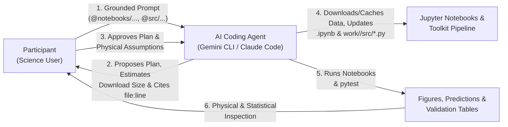

# Workshop Preparation Guide for Project Developers

This document provides instructions and a one-week execution plan for project developers to organize, build, and verify the materials for our **1.5-day AI-Assisted Scientific Computing Workshop**.

---

## 1. Introduction: Overall Mechanics of the Workshop

### 1.1 The Core Paradigm: Prompt-Driven Jupyter Notebooks with AI Coding Agents

This workshop is built around **Jupyter Notebooks (`.ipynb`)** backed by our project's Python toolkit (`src/<toolkit>/`) and operated through **AI-assisted coding agents** (e.g., Gemini CLI, Claude Code, Codex, Cursor).

Unlike a traditional tutorial where participants passively press `Shift+Enter` on pre-written cells—or a traditional hackathon where participants spend hours writing and debugging raw boilerplate code by hand—this workshop uses an **agent-mediated scientific workflow**:

> **Participants do not manually write or edit large blocks of code inside the notebooks.** Instead, they act as **science users**, issuing grounded natural-language prompts to a coding agent to:
> 1. **Discover, download, and ingest data**—whether fetching slices from our project's online data archives, downloading external datasets brought by the participant from the internet, or loading pre-staged local benchmark catalogs—using idempotent caching and official toolkit loaders,
> 2. **Modify, parameterize, and update Jupyter notebooks** (and companion `.py` helper modules) to run the project's pretrained models and artifacts on new events, datasets, or parameter regimes,
> 3. **Run the notebooks and automated sanity checks**, and
> 4. **Analyze, validate, and critique the scientific results** against domain baselines, audit for subtle physical/statistical pitfalls, and package their validated workflow into a reusable **Agent Skill**.



### 1.2 Operational Focus: Using Project Models & Artifacts (Not Retraining Models)

The primary goal of the workshop is **operational and scientific**: enabling science users to **use the pretrained models, calibrated pipelines, embeddings, and derived artifacts already built by the project** to generate predictions, analyze physical events, and answer domain science questions.

> [!IMPORTANT]
> **Inference & Analysis Only — No Model Retraining:**
> Science users **do not train or retrain machine learning models** during the workshop. Retraining models introduces heavy compute bottlenecks, hyperparameter tuning distractions, and training-pipeline complexity that divert time away from scientific exploration.
>
> Instead, all workshop notebooks and participant projects treat the project's models and artifacts as **operational scientific instruments**. Participants use the coding agent to:
> - **Run inference and generate predictions** with the project's pretrained model checkpoints on new time intervals, events, or input channel configurations,
> - **Query and analyze precomputed project artifacts** (such as model embeddings, prediction catalogs, reconstructions, or attribution maps) alongside observational datasets,
> - **Combine project predictions/artifacts with external datasets** downloaded from the internet or brought by the participant, and
> - **Evaluate operational performance and physical plausibility** across different physical regimes, viewing geometries, or event classes against domain baselines (e.g., Persistence, Climatology, or standard physical models).

### 1.3 Why This Mechanics Changes How Developers Must Prepare Notebooks & Data Access

To make the agent-mediated notebook mechanics work reliably across 15–25 participants, **our workshop repository must be engineered for both human science users and coding agents**:
1. **Thin, modular notebooks (`notebooks/01_...` to `05_...`)**: Every cell is short ($\le 25$ lines), calls high-level functions from `src/<toolkit>/` (for data ingestion, preprocessing, model inference, and artifact analysis), and defines configurable inputs clearly in the top cell.
2. **Helper logic (including custom data downloaders/adapters) extracted to `.py` files**: For custom participant analyses in Module 4, the agent writes reusable functions—including any download scripts or adapters for participant-brought external datasets—into `work/<name>/src/*.py` with unit tests in `work/<name>/tests/`, keeping the notebook cells clean.
3. **Explicit domain context (`GEMINI.md` / `AGENTS.md` / `CLAUDE.md`)**: A concise ($\le 150$-line) root instruction file loaded automatically by the coding agent that enforces *Toolkit First*, *Use Pretrained Models & Artifacts (Do Not Retrain)*, *Plan Before Code*, *Dry-Run & Cache Before Downloading*, *Cite `file:line`*, and our toolkit's non-negotiable physical and statistical conventions.
4. **Loud runtime guardrails**: Toolkit functions raise clear `ValueError` exceptions whenever an agent passes wrong units, uncalibrated data levels, naive timestamps, or invalid model inputs.
5. **Hybrid Data & Artifact Architecture (Local Cache + Controlled Remote Fetching)**:
   - **Pre-staged / fast-mirror benchmark datasets, checkpoints, and artifacts (`data/` & `artifacts/`)** so tutorial notebooks and fallback cases work instantaneously even if external archives throttle the venue Wi-Fi,
   - **Bounded, idempotent remote fetchers (`<toolkit>.io`)** that estimate download volume (`dry_run=True`), enforce size caps, and cache files locally (`data/cache/`) so notebooks never download the same file twice, and
   - **External data ingestion patterns** so participants who download their own datasets from the internet can validate and adapt them into the toolkit's format safely.

---

## 2. Structure of the Workshop: Modules `M0` to `M6` (The GRASP Ladder)

The 1.5-day curriculum follows the **GRASP** progression (**G**round $\to$ **R**eproduce $\to$ **A**rticulate $\to$ **S**olve $\to$ **P**rove & Skillify). Across modules `M0`–`M6`, the coding agent's autonomy expands only as the science user demonstrates mastery of the toolkit, its pretrained models/artifacts, and its physical assumptions.

| Module | Time | Agent Role | Participant Role | How Participants Use the Agent with Notebooks, Models & Data | Key Deliverable / Gate |
|---|---|---|---|---|---|
| **M0 · Setup & First Contact** | Day 1<br/>30 min | **Environment Checker** | Operator | Prompt agent to summarize rules loaded from `GEMINI.md`, list the notebooks in `@notebooks/README.md`, verify local data/model cache + remote archive connectivity via `env/check_setup.py`, and run `pytest -q tests/`. | Green setup, model checkpoint & data-access check; `work/<name>/` sandbox initialized. |
| **M1 · GROUND** | Day 1<br/>60 min | **Tutor**<br/>*(Read-Only)* | Learner & Fact-Checker | Prompt agent to map `@src/<toolkit>/` (loaders, preprocessing, pretrained model inference, artifacts) and `@notebooks/README.md` (`G1`), explain a tutorial notebook cell-by-cell (`G2`), quiz the participant on physical assumptions (`G3`), and assemble a personal cheat sheet (`G4`). | `work/<name>/notes/toolkit_map.md` & `my_cheatsheet.md` with **3 manually verified `file:line` citations**. |
| **M2 · REPRODUCE** | Day 1<br/>60 min | **Navigator** | Experimentalist | Prompt agent to run a baseline inference/prediction notebook and summarize its metrics and warnings (`R1`), then plan, create, and run a modified notebook variant that fetches/loads a new event window, channel configuration, or operational parameter (`R2`) and analyze how the predictions changed physically. | Executed variant notebook `work/<name>/<variant>.ipynb` + 3-sentence physical interpretation of the perturbation. |
| **M3 · ARTICULATE** | Day 1<br/>60 min | **Skeptical Collaborator**<br/>*(No Code Allowed)* | Science User (Scoping) | Prompt agent to challenge scope and draft a 5-hour Minimum Viable Science plan (`PLAN.md`) specifying how the project's pretrained models/artifacts will be applied, the exact data source (cached project data, bounded download from project archive, or participant-brought internet dataset), estimated download size, fallback slice, and toolkit functions per step (`A1`–`A2`). | **`PLAN.md` signed off by a facilitator at the Plan Gate (`A3`)** (verifying operational scope & data download size) before custom code is written. |
| **M4 · SOLVE (Sprint 1)** | Day 1<br/>120 min | **Pair Programmer** | Science User & Code Reviewer | Prompt agent in a strict *Plan $\to$ Approve $\to$ Download/Ingest $\to$ Update `.py` & `.ipynb` $\to$ Run $\to$ Sanity-Check* loop (`S1`–`S4`) to fetch and cache required data, adapt any external dataset headers/units, run pretrained model inference or artifact queries in the notebook, run physical unit/range assertions, and generate a First-Light plot. End Day 1 with `HANDOFF.md` (`S6`). | Cached & validated dataset + **90-Minute First-Light Plot (`figures/first_light.png`)** passing facilitator check + `test_sanity.py` + `HANDOFF.md`. |
| **M5 · SOLVE (Sprint 2) + PROVE** | Day 2<br/>85 min | **Hostile Journal Referee** | Defender & Validator | Finish MVP notebook (40 min), then switch agent to Hostile Referee mode (45 min): prompt agent to compare predictions against domain baselines (`P1`), audit the notebook/code for lookahead, alignment errors & circularity (`P2`), run benchmark event & negative-control checks (`P3`), critique the findings as a hostile referee (`P4`), and add block-bootstrapped error bars (`P5`). | `results_table.md` (with baselines & CIs), `figures/main_result.png`, evaluation audit report, and 1 executed referee test. |
| **M6 · PACKAGE, SKILLIFY & PRESENT** | Day 2<br/>100 min | **Skill Architect & Technical Editor** | Author & Presenter | Prompt agent to clean and re-run the final notebook end-to-end from cached data (`X1`), generate a 1-page `FINDINGS.md` (`X2`), distill the notebook pipeline + `ERROR_LOG.md` into a reusable **Agent Skill** (`skills/<name>/SKILL.md` + CLI script) (`X3`), test a pod-mate's skill in a fresh session (`X4`), and file toolkit GitHub issues (`X5`). | Reproducible `final_verified.ipynb`, `FINDINGS.md`, validated `skills/<name>/`, and 5-min lightning talk. |

---

## 3. One-Week Plan to Deliver the Workshop Materials

Below is the structured plan for the development team to design, implement, and verify all workshop materials during the preparation week. It is organized around the **three primary deliverables**—**(3.1) Scientific Goals, Pretrained Artifacts & Hybrid Data Plan**, **(3.2) Workshop Notebooks**, and **(3.3) The Participant Guide & Prompt Catalog**—followed by the **day-by-day execution schedule (3.4)**.

---

### 3.1 Deliverable 1: Scientific Goals, Benchmark Cases & Hybrid Data/Artifact Architecture

Before writing or refactoring notebooks, the development team must define **what operational and scientific outcomes participants will achieve** using the project's models and artifacts, and engineer a **resilient data and artifact access layer** that supports both fast pre-staged slices and controlled live downloads.

#### A. Core Scientific & Operational Goals for Every Participant
By the end of the workshop, every participant must achieve five concrete goals using our toolkit via their coding agent:
1. **Master Data Discovery, Bounded Downloading & Physical Preprocessing**: Query remote archives or external URLs safely (checking file counts and sizes before downloading), cache data locally, and trace raw inputs through calibration, coordinate registration, quality/gap masking, and model-input assembly—verifying physical units and coordinate frames at every step.
2. **Operate Pretrained Project Models & Artifacts Across Regimes**: Run the project's pretrained models and inspect derived artifacts (predictions, embeddings, reconstructions, attribution maps) through the coding agent, systematically evaluating how perturbing an operational parameter—or fetching a new event slice from the online archive—changes the scientific output.
3. **Enforce Operational Evaluation Integrity**: Evaluate predictions without lookahead leakage, threshold-tuning circularity, or timestamp misalignment when joining multi-source or external catalogs.
4. **Complete a Falsifiable 5-Hour Science Investigation (MVP) with Rigorous Validation**: Formulate a focused science question (using project models/artifacts on project data or participant-brought internet data), implement the analysis via agent-directed notebook + `.py` steps, benchmark against built-in domain baselines (e.g., Persistence and Climatology), validate on a **known positive benchmark event** and a **quiet/negative-control interval**, and compute domain-aware uncertainty intervals.
5. **Publish a Reusable Agent Skill for the Community**: Encapsulate their validated operational workflow (including its data-fetching/caching, preprocessing, inference, and evaluation guardrails) into a standalone `skills/<skill-name>/SKILL.md` + parameterized CLI script so any science user can run the analysis on new dates or events in a single prompt.

#### B. Define 3 Concrete Science User Personas / Backup Science Cases (`Case α`, `Case β`, `Case γ`)
Not every participant arrives with a well-scoped 5-hour question, and some participants will bring external data ideas that turn out to be too large or unavailable online. Developers **must define and stage data/artifacts for 3 canonical operational science cases** (none of which require retraining models):

| Case | Archetype | What Developers Must Define for the Project | Data & Artifact Access Pattern Demonstrated | Target Reusable Skill in `M6` |
|---|---|---|---|---|
| **Case α** | **Input Channel / Calibration Sensitivity on Model Predictions** | A science question testing **how input channel availability or instrument calibration affects pretrained model predictions** (e.g., running inference with degraded/missing channels or omitting time-dependent degradation correction and quantifying the resulting prediction bias). | Uses pre-staged Tier-2 multi-channel cubes + fetches 1 updated calibration table or event slice from the online archive + runs pretrained model inference. | `skills/<channel-or-calibration-skill>/` |
| **Case β** | **Geometric / Spatial / Regime Stratification of Operational Skill** | A science question auditing **how the pretrained model's predictions perform across spatial coordinates, viewing geometry, latitude/longitude bins, or physical activity regimes**, exposing where operational skill degrades and testing a post-processing or threshold calibration adjustment. | Queries the remote catalog/archive to download a targeted subset of events into `data/cache/` and stratifies precomputed predictions/inference outputs. | `skills/<geometry-or-regime-audit-skill>/` |
| **Case γ** | **Cross-Dataset Analysis with Precomputed Project Artifacts & External Data** | A science question combining **Tier-1 precomputed project artifacts (e.g., embeddings, prediction time series, or derived physical parameters)** with an **external online catalog or auxiliary time series downloaded from the internet** (e.g., an external event list, solar wind/geomagnetic index, or secondary instrument log) to test a physical hypothesis or lead-time relationship. | Demonstrates downloading an external internet catalog/file into `work/<name>/data/`, aligning timestamps/units, and analyzing it against precomputed project artifacts on CPU. | `skills/<cross-dataset-analysis-skill>/` |

#### C. Engineer the Hybrid Data & Artifact Architecture (`data/` + Remote Fetching)
Because project datasets, model artifacts, and participant-brought datasets may live on the internet, developers must support **three pathways** while protecting the workshop from conference Wi-Fi bottlenecks and upstream archive outages:

1. **Pathway 1 — Pre-Cached / Fast-Mirror Core Tiers (`data/catalogs/`, `data/artifacts/`, `data/cubes/`, `data/events/`)**:
   - Stage (or provide a 1-command `python env/prefetch_data.py` script pulling from a fast cloud mirror such as S3/GCS/Zenodo/HuggingFace) three tiers of operational assets:
     - **Tier 1 (`data/artifacts/`, `data/catalogs/`, $< 250\,\text{MB}$)**: Pretrained model checkpoints, precomputed model predictions/embeddings across multi-year benchmark periods, and tabular event catalogs that load and analyze in $< 5\,\text{s}$ on CPU.
     - **Tier 2 (`data/cubes/`, $1\text{–}4\,\text{GB}$)**: Downsampled, co-aligned multi-channel arrays for running preprocessing and live pretrained model inference in $< 15\,\text{s}$.
     - **Tier 3 (`data/events/`, $< 2\,\text{GB}$)**: Full-resolution slices for **Benchmark Event 1** (primary active event), **Benchmark Event 2** (perturbation active event), and **Benchmark Event 3** (quiet/negative-control interval).
2. **Pathway 2 — Bounded, Idempotent Project Archive Downloader (`<toolkit>.io.fetch_...` $\to$ `data/cache/`)**:
   - Provide a first-class download function in `src/<toolkit>/io.py` for fetching additional dates, wavelengths, events, or model artifacts from our project's online servers/APIs.
   - **Mandatory Agent Safety Features**:
     - `dry_run: bool = False` (or a companion `estimate_download()` function) that queries the remote server and returns the **number of files and estimated total MB** *before* downloading a single byte.
     - `max_size_mb: float = 500.0` guardrail that raises a `ValueError` if an agent attempts an unbounded multi-gigabyte download without explicit override.
     - **Idempotent local caching** in `data/cache/` (keyed by query parameters or file hash) so re-running a notebook cell **never re-downloads** files already on disk.
     - Clear timeout and retry handling with a helpful error message pointing to the pre-cached fallback slices in `data/` if the remote server is unreachable.
3. **Pathway 3 — Participant-Brought Internet Data Ingestion (`work/<name>/data/`)**:
   - Participants bringing their own datasets from external URLs, virtual observatories (e.g., VSO, JSOC, CDAWeb, MAST), Zenodo, or institutional servers store downloaded files in `work/<name>/data/` (git-ignored).
   - Provide a lightweight validation utility (e.g., `<toolkit>.io.validate_external_dataset()`) or template script that checks external data for the four most common compatibility bugs when agents ingest internet data:
     1. **Time standard & timezone**: Ensuring timestamps are converted to UTC observation times (not local time or file-download timestamps),
     2. **Physical units & scaling**: Verifying physical units (`astropy.units` or metadata keys) match what `<toolkit>.prep` and the pretrained models expect,
     3. **Coordinate frame & grid**: Checking WCS headers or spatial coordinate conventions before co-alignment, and
     4. **Missing-value / fill-value sentinels**: Converting instrument fill values (e.g., `-9999`, `-1e31`) to `np.nan` before running inference or computing statistics.

#### D. Developer Architecture Inventory Worksheet
As your first task on Day 1 of preparation, fill out this inventory table with the development team to lock in the public surface area exposed to participants and agents:

| Toolkit Layer | Target Module in `src/<toolkit>/` | Core Public Functions / Classes (15–20 Total) | Key Physical Units, Coordinate Frames & Guardrails to Enforce |
|---|---|---|---|
| **1. Remote Fetching, Caching & Loaders** | `src/<toolkit>/io.py` | e.g., `query_archive()`, `fetch_data(..., dry_run=True, max_size_mb=500)`, `load_observation()`, `load_catalog()`, `load_artifacts()`, `validate_external_dataset()` | Idempotent caching in `data/cache/`; enforce `max_size_mb` cap; require UTC-aware timestamps; convert sentinel fill values to `NaN`. |
| **2. Calibration & Registration** | `src/<toolkit>/prep.py` | e.g., `register_level15()`, `correct_degradation()`, `correct_projection()`, `coalign_channels()`, `scale_inputs()` | State exact input/output units; raise `ValueError` on double normalization or uncalibrated inputs. |
| **3. Target Alignment & Regime Slicers** | `src/<toolkit>/labels.py` | e.g., `align_event_catalog()`, `slice_by_regime()`, `exclude_data_gaps()` | Mask data/eclipse gaps as `NaN` (never `0`); enforce strict UTC lookahead boundaries (`t <= t0`). |
| **4. Pretrained Models, Artifacts & Baselines** | `src/<toolkit>/models.py` | e.g., `load_pretrained_model()`, `run_inference()`, `extract_embeddings()`, `PersistenceBaseline`, `ClimatologyBaseline` | Inference-ready (`model.eval()`); shared `.predict()` interface across pretrained models and baselines; verify input tensor scaling before forward pass. |
| **5. Evaluation, Attribution & Plots** | `src/<toolkit>/eval.py` | e.g., `compute_skill_metrics()`, `calibrate_threshold()`, `block_bootstrap_metric()`, `attribute_regions()`, `plot_event_diagnostics()` | Require pre-calibrated threshold as explicit kwarg; block bootstrap over physical rotation/event blocks. |

---

### 3.2 Deliverable 2: List of Notebooks to Be Developed and Organized

Developers must prepare and test **8 notebooks total** (5 Core Tutorial Notebooks + 3 Backup Case Starter Notebooks) plus a master `notebooks/README.md` index table. Every notebook must be structured so a coding agent can read, explain, modify, download/cache data through, and execute it reliably—focusing on **operational inference and artifact analysis rather than model retraining**.

#### Group 1: The 5 Core Tutorial Notebooks (`notebooks/01_...` to `05_...`)
These five notebooks form the backbone of the workshop. Participants use them in **M1 (Ground)** to learn the toolkit, in **M2 (Reproduce)** to run baseline and perturbed inference workflows (including fetching new slices), and in **M3–M5 (Articulate, Solve, Prove)** as building blocks for their own investigation.

| Notebook Filename (Adapt Name to Domain) | Pedagogical Role in Workshop | What the Notebook Must Demonstrate | Target Data Tier & Max Runtime |
|---|---|---|---|
| **`notebooks/01_ingest_and_calibration.ipynb`** | **Remote Querying, Caching, Data Ingestion & Calibration** | Running a bounded archive query (`dry_run=True`), downloading/caching a small observation slice into `data/cache/` (with instant fallback to `data/events/`), inspecting headers/metadata/units, applying pointing/coordinate registration, instrument degradation/exposure normalization, boundary/quality masking, and plotting calibrated vs. uncalibrated physical quantities. | Tier 3 (`data/events/` or cached fetch)<br/>$\le 25\,\text{s}$ |
| **`notebooks/02_coalignment_and_model_inputs.ipynb`** | **Multi-Source Co-Alignment, Tensor Assembly & Catalog Matching** | Co-aligning multiple instruments/channels (including aligning an external/downloaded catalog) onto a synchronized spatial/temporal grid, handling observation gaps safely, scaling physical channels into inference-ready input tensors, and matching timestamps to target events without lookahead. | Tier 2 (`data/cubes/`) + `catalogs/`<br/>$\le 30\,\text{s}$ |
| **`notebooks/03_pretrained_inference_and_baselines.ipynb`** | **Operational Model Inference & Baseline Benchmarking** | Loading the project's pretrained model checkpoint, running operational inference/predictions on Tier-2 data, applying reference decision thresholds, and comparing domain skill metrics against `PersistenceBaseline` and `ClimatologyBaseline`. **Used in `R1` reproduction.** | Tier 2 (`data/cubes/`)<br/>$\le 40\,\text{s}$ |
| **`notebooks/04_artifacts_embeddings_and_regime_analysis.ipynb`** | **Fast Multi-Year Analysis with Precomputed Artifacts & Embeddings** | Loading precomputed Tier-1 project artifacts (model predictions, embeddings, or derived catalogs in `data/artifacts/`) and joining them with local or downloaded auxiliary datasets to slice performance across physical regimes, run channel/calibration sensitivity comparisons, or perform embedding similarity searches in seconds on CPU, including block-bootstrapped confidence intervals. **Primary template for `R2` and `M4` MVPs.** | Tier 1 (`data/artifacts/`)<br/>$\le 10\,\text{s}$ |
| **`notebooks/05_event_diagnostics_and_attribution.ipynb`** | **Event Case Studies, Attribution & Visual Diagnostics** | Running deep-dive operational diagnostics on a benchmark event (`data/events/` or a newly downloaded event in `data/cache/`): predicted event timelines, reliability/calibration diagrams, and spatial/physical attribution maps. **Wrapped by the gold-standard reference skill in `skills/`.** | Tier 3 (`data/events/` or `data/cache/`)<br/>$\le 30\,\text{s}$ |

> **Mandatory Companion Index (`notebooks/README.md`)**:
> Create `notebooks/README.md` containing a single markdown lookup table:
> `| Notebook | Science / Operational Question Answered | Key Toolkit Functions & Pretrained Artifacts Used | Data Source / Tier Used | Expected Runtime |`
> Coding agents read `@notebooks/README.md` first whenever a participant asks *"How do I download data, run predictions, or analyze artifacts with this toolkit?"*

#### Group 2: The 3 Backup Science Case Starter Notebooks (`backup_cases/`)
For participants who need a ready-made project at the Module 3 Plan Gate (`A3`)—including anyone whose custom external internet data source turns out to be offline or too large to download during the session—provide three folders (`backup_cases/case_alpha/`, `case_beta/`, `case_gamma/`), each containing:
- A pre-approved `PLAN.md` scoped to $\le 5$ hours (using pretrained models/artifacts with zero model retraining) and its target `M6` skill name,
- A starter notebook `starter_analysis.ipynb` (and 15-line `starter_check.py`) that points to both the remote query parameters and the pre-cached local `data/` and `data/artifacts/` slices so the participant can immediately begin prompting their coding agent in Module 4.

#### Mandatory Engineering Standards for All Workshop Notebooks
Every notebook in `notebooks/` and `backup_cases/` **MUST** satisfy four rules:
1. **Top Configuration Cell**: Cell 1 of every notebook must define all configurable variables (`DATA_DIR`, `ARTIFACTS_DIR`, `CACHE_DIR`, `USE_PREFETCHED_CACHE`, `MODEL_CHECKPOINT`, `EVENT_ID`, `START_DATE`, `END_DATE`, `CHANNELS`, `HORIZON_HOURS`, `OUTPUT_DIR`) with sensible defaults so the coding agent can inspect and modify operational or download parameters in one predictable location.
2. **Short, Self-Contained Cells ($\le 25$ lines)**: Break long cells into logical steps with descriptive markdown headers (`## Step 1: Query & Cache Data...`, `## Step 2: Load & Calibrate...`, `## Step 3: Run Pretrained Model Inference...`). Move complex download loops, adapters, or plotting boilerplate into `src/<toolkit>/`.
3. **Committed Outputs**: Execute all tutorial notebooks before committing so participants and agents can inspect existing cell outputs and figures immediately upon cloning.
4. **Idempotent Caching & Bounded Download Guarantee**: Any cell that downloads data from the internet must (a) check `data/cache/` first so subsequent notebook runs execute in $< 60$ seconds with zero redundant network traffic, (b) enforce a size limit (`max_size_mb`), and (c) fall back cleanly to pre-staged data if offline.

---

### 3.3 Deliverable 3: Participant Guide — How to Interact with Notebooks & Prompt the Coding Agent

Developers must prepare `participant-guide.md` (and `prompts/*.md`) so participants have a clear operational manual explaining **how to work with notebooks, pretrained models/artifacts, and remote/external datasets through a coding agent** and **concrete copy-pasteable prompt examples** for every module of the workshop.

Below is the exact operational framework and prompt catalog that developers must customize with the project's function names, model checkpoints, artifact paths, remote APIs, and science cases.

#### A. How Participants Interact with Notebooks & Online Data (The Golden Rules for the Participant Guide)

Include this workflow explanation at the front of the Participant Guide:

1. **You Direct; The Agent Downloads, Edits, and Runs**:
   - Keep JupyterLab (or VS Code / Colab notebook viewer) open on half your screen to **view** markdown, code diffs, tables, and plots.
   - Keep your **AI Coding Agent CLI** (Gemini CLI, Claude Code, Codex) open in your terminal in the repository root on the other half of your screen.
   - Instead of typing code into notebook cells manually, **issue prompts to the agent** referencing exact files with `@` (e.g., `@notebooks/01_ingest_and_calibration.ipynb`, `@src/<toolkit>/io.py`, `@data/README.md`).
2. **Operate Pretrained Models & Artifacts — Do Not Retrain**:
   - Your goal in this workshop is to use the project's pretrained models, embeddings, and artifacts as scientific instruments to make predictions and test domain hypotheses on cached or newly downloaded data.
   - If the coding agent proposes training a new neural network or fitting a model from scratch, stop it: *"Use the pretrained model / precomputed artifacts in `<toolkit>.models` and `data/artifacts/` instead of retraining."*
3. **The Two-Step Prompting Ritual (*Plan First $\to$ Update & Run Second*)**:
   - **Never** ask the agent to *"download the data and build my whole analysis notebook"* in one shot.
   - **Step 1 (Plan, Estimate Size & Cite)**: Ask the agent to inspect the reference notebook and toolkit source, list which cells or `.py` functions need to be created/modified with exact `file:line` citations, run a dry-run size check if downloading remote data, state the physical units/assumptions, and **wait for your approval**.
   - **Step 2 (Apply, Execute & Inspect)**: Once you approve the plan, instruct the agent to download/cache the data, write reusable processing functions into `work/<name>/src/<module>.py`, update the notebook cells to call those functions, execute the notebook, and report the output predictions, metrics, and figures.
4. **Safe Remote Data Downloading (*Dry-Run $\to$ Cache $\to$ Single-File Inspect*)**:
   - Whether you are pulling from the project's online archive or downloading your own dataset from an external URL/API:
     1. **Estimate first**: Have the agent query the remote source (`dry_run=True` or `HEAD`/metadata check) and report the file count and total MB before downloading. Keep workshop downloads under **$\sim 500\,\text{MB}$** so you don't spend your 5 hours waiting on Wi-Fi.
     2. **Cache locally**: Always download into `data/cache/` or `work/<name>/data/` with existence checks so re-running your notebook never re-downloads the data.
     3. **Inspect 1 sample file before bulk processing**: When bringing external internet data, have the agent download **one** file/chunk first, print its headers/columns, units, timestamp format, and missing-value sentinels, and write an adapter function in `work/<name>/src/` before running the full pipeline.
5. **Why Reusable Code Goes in `work/<name>/src/*.py` and Plots Stay in `.ipynb`**:
   - Having the agent edit 200-line downloaders or analysis functions directly inside `.ipynb` JSON is slow, error-prone, and impossible to unit-test with `pytest`.
   - Instead, instruct the agent: *"Put the downloader/adapter and inference/analysis functions in `work/<name>/src/<module>.py`, write a quick unit test in `work/<name>/tests/`, and keep the notebook cell to 5–10 lines that import the function and plot the result."*
   - Bonus: In Module 6 (`X3`), wrapping `work/<name>/src/*.py` into a reusable **Agent Skill** takes 5 minutes because your logic is already modular!

---

#### B. Catalog of Prompt Patterns & Concrete Examples (To Adapt in `participant-guide.md`)

Developers must provide concrete examples for each of the **six core notebook interaction patterns** below, substituting our toolkit's actual module/function names, pretrained model checkpoints, remote archive APIs, and staged datasets:

##### Pattern 1: Inspecting & Understanding an Existing Notebook (`M1 · Ground`)
Participants prompt the agent to explain what a notebook does scientifically, how it fetches/loads data and runs pretrained models, and what physical assumptions it makes—without executing or modifying files.

> **Example Prompt — Cell-by-Cell Scientific Walkthrough (`G2`):**
> ```text
> Walk me through @notebooks/01_ingest_and_calibration.ipynb cell by cell, for a domain scientist who is an intermediate Python programmer.
> For each cell, state:
> (a) What it does scientifically (including how it queries, caches, or loads the data),
> (b) Which `<toolkit>` function it calls and what that function assumes (physical units, data calibration level, coordinate frame, cadence, masking), citing `src/<toolkit>/<file>.py:<line>`, and
> (c) One thing that would silently go wrong scientifically if I pointed this notebook at a different downloaded dataset.
> Keep it under 600 words. Do not execute or modify any files.
> ```
>
> **Example Follow-Up Prompt — Checking Pretrained Model Input Conventions in a Cell:**
> ```text
> Look closely at Cell 5 of @notebooks/03_pretrained_inference_and_baselines.ipynb and @src/<toolkit>/models.py.
> What exact channel order, physical units, and intensity scaling does `load_pretrained_model()` expect during inference, and where in `@src/<toolkit>/prep.py` is exposure-time normalization applied? Cite exact `file:line` numbers so I don't feed uncalibrated inputs into the pretrained model.
> ```

##### Pattern 2: Reproducing an Inference Notebook & Perturbing Parameters or Target Events (`M2 · Reproduce`)
Participants prompt the agent to run a reference inference notebook, inspect its predictions and warnings, and then create and run a modified notebook variant that generates predictions on a new event (either from local `data/events/` or fetched on-demand into `data/cache/`), channel subset, or operational configuration.

> **Example Prompt — Baseline Inference Notebook Execution (`R1`):**
> ```text
> Run @notebooks/03_pretrained_inference_and_baselines.ipynb from top to bottom without modifying its code.
> Report:
> 1. Total execution time,
> 2. Every warning emitted during cell execution (including header, coordinate, or NaN warnings), and
> 3. The exact operational prediction metrics and baseline comparison scores printed in the final cells.
> Do not edit any files—just execute and report.
> ```
>
> **Example Prompt — Modifying a Notebook to Fetch & Predict on a New Event (`R2`):**
> ```text
> I want to create a modified version of @notebooks/05_event_diagnostics_and_attribution.ipynb that runs the pretrained model and spatial attribution on a different active event (`<START_DATE>` to `<END_DATE>`).
>
> Step 1 (Plan & Data Check only — do NOT edit files or download bulk data yet):
> - Check `@data/README.md` to see if this date range is already in `data/events/`. If not, run `<toolkit>.io.fetch_data(..., dry_run=True)` to check how many files and megabytes it would take to download into `data/cache/`.
> - List every cell and parameter in `@notebooks/05_event_diagnostics_and_attribution.ipynb` that must change (file paths/query dates, event identifier, plotting bounds).
> - Flag any physical or calibration assumptions in `<toolkit>` that could behave differently for this event (e.g., instrument degradation epoch, viewing geometry, cadence).
> Wait for my approval.
>
> Step 2 (After I approve):
> - Fetch/cache the slice if needed, create `work/<name>/05_event_variant.ipynb`, apply the changes, execute all cells, and summarize how the predicted timeline and attribution map changed between the two events.
> ```

##### Pattern 3: Downloading Remote Data, Ingesting Participant-Brought Datasets & Running Pretrained Predictions (`M4 · Solve`)
In Module 4, participants may either (a) download a targeted slice from the project's online archive and run the pretrained model on it, or (b) download and adapt an external dataset they brought from the internet to compare against the project's predictions/artifacts, before generating their First-Light diagnostic plot. Developers must include both prompt examples in the Participant Guide:

> **Example Prompt 3A — Downloading a New Slice from the Project Archive & Running Pretrained Inference (`S1 — Project Archive`):**
> ```text
> We are implementing Step 1 of @work/<name>/PLAN.md:
> "Fetch and cache observations for `<START_DATE>` to `<END_DATE>` across channels `<CHANNELS>`, construct calibrated input variants (with vs. without `correct_degradation()`), and run `<toolkit>.models.run_inference()` using the pretrained checkpoint."
>
> Constraints:
> 1. First run a dry-run query using `<toolkit>.io` (`cite src/<toolkit>/io.py:<line>`) to verify the total download size is under 500 MB and check what is already cached in `data/cache/`.
> 2. Do NOT retrain any model—use the pretrained model checkpoint and inference helpers in `<toolkit>.models`.
> 3. Write a reusable data-fetching, preprocessing, and inference module in `work/<name>/src/inference_pipeline.py` that caches downloaded files idempotently in `data/cache/`.
> 4. Write a fast unit test in `work/<name>/tests/test_inference_pipeline.py` on a 2-timestamp sample verifying local cache hits, finite physical units, and valid prediction outputs.
> 5. Update `work/<name>/analysis.ipynb` so Cell 2 imports `inference_pipeline`, runs the predictions on the cached dataset, and displays a summary table of time ranges, channel medians, and predicted outputs.
>
> Show me the dry-run size estimate and a 6-line implementation plan first, and wait for my approval.
> ```
>
> **Example Prompt 3B — Downloading & Adapting a Participant-Brought Internet Dataset (`S1 — External Data`):**
> ```text
> For my science project in @work/<name>/PLAN.md, I want to download an external dataset from `<URL / API / Zenodo / CDAWeb / VSO>` and analyze/evaluate it alongside `<toolkit>`'s pretrained model predictions and artifacts in `data/artifacts/`.
>
> Step 1 (Single-Sample Probe & Compatibility Plan — do NOT bulk download yet):
> 1. Download ONLY a single sample file (or the first 100 rows / 1 day of data) into `work/<name>/data/sample/` and inspect its structure.
> 2. Compare its format against `@src/<toolkit>/io.py` and `@src/<toolkit>/prep.py`, and report:
>    - Exact column names, array shapes, and FITS/NetCDF/Parquet metadata keys,
>    - Time standard and timezone (and how to convert it to UTC observation time matching `<toolkit>`),
>    - Physical units and coordinate frame (and what unit conversion or rescaling is required),
>    - Missing-data or fill-value sentinels (e.g., `-9999`, `NaN`) and cadence gaps,
>    - Estimated total download size for my full target date range (`<START_DATE>` to `<END_DATE>`).
> Wait for my approval.
>
> Step 2 (After I approve):
> 1. Write `work/<name>/src/external_adapter.py` with a cached downloader (`work/<name>/data/`) and an adapter function that aligns the external data with `<toolkit>`'s predictions/artifacts and physical units.
> 2. Write `work/<name>/tests/test_external_adapter.py` asserting UTC timestamps, unit consistency, and `NaN` masking of fill values.
> 3. Update `work/<name>/analysis.ipynb` to import `external_adapter`, ingest the data, and print a verification summary.
> ```
>
> **Example Prompt 3C — Adding a First-Light Diagnostic Plot Cell (`S2`):**
> ```text
> Add a "First-Light Diagnostic" section to `work/<name>/analysis.ipynb` (and save the figure to `work/<name>/figures/first_light.png`) that plots:
> 1. Top row: a multi-panel view at `<benchmark_timestamp_utc>` showing each ingested physical channel in its calibrated physical units alongside the pretrained model's spatial attribution/output using `<toolkit>`'s plotting helpers, with coordinate grid overlays and labeled axes.
> 2. Bottom row: time series of the pretrained model's predictions over the target interval compared against our calibrated input summary and target catalog on the right axis.
> Show me the cell plan first. After I approve, update the notebook, execute the cells, and confirm that `work/<name>/figures/first_light.png` was created cleanly.
> ```

##### Pattern 4: Auditing the Participant's Notebook for Evaluation Circularity & Data Alignment Bugs (`M5 · Prove`)
Participants prompt the agent to cross-check their notebook and helper modules (including any downloaded/external data joins) against the toolkit's domain rules to catch subtle methodological flaws.

> **Example Prompt — Auditing the Notebook for Lookahead, Alignment & Physical Circularity (`P2`):**
> ```text
> Audit my analysis notebook `@work/<name>/analysis.ipynb` and helper modules in `@work/<name>/src/` for evaluation circularity, timestamp misalignment, and physical bugs. Check every item below and cite exact cell numbers and `file:line`:
> 1. Forecast horizon lookahead: for issue time `t0`, do any input channels, rolling statistics, or external catalog joins use observations recorded after `t0`?
> 2. Multi-source / downloaded data alignment: when we joined downloaded or external data with project predictions/artifacts, were they matched strictly on UTC observation timestamps (`max_dt` tolerance) without forward-filling future values or misinterpreting timezones/cadence windows?
> 3. Event-in-progress contamination: how do the operational metrics change if we exclude timestamps where an active event is already underway at `t0`?
> 4. Threshold & calibration discipline: was the operational decision threshold fixed from the reference calibration set rather than tuned retrospectively on our target evaluation events?
> 5. Data gap & fill-value handling: are instrument dropout intervals and external fill values masked out as `NaN` rather than treated as real zero/quiet measurements?
> Output a severity-ranked markdown table. Do not modify any files yet.
> ```

##### Pattern 5: Running Baselines, Uncertainty Quantification & Hostile Referee Tests in the Notebook (`M5 · Prove`)
Participants prompt the agent to augment their notebook with fair baselines, block-bootstrapped error bars, and a fast empirical check addressing a journal referee's objection.

> **Example Prompt — Adding Baselines & Block-Bootstrapped Error Bars (`P1` + `P5`):**
> ```text
> Update `work/<name>/analysis.ipynb` to add a "Baseline & Uncertainty Evaluation" section:
> 1. Over the exact same evaluation timestamps and pre-calibrated threshold policy, compare our pretrained model predictions/variants against `<toolkit>.models.PersistenceBaseline` and `<toolkit>.models.ClimatologyBaseline`.
> 2. Compute 95% confidence intervals on all evaluation metrics for every method using `<toolkit>.eval.block_bootstrap_metric` grouped by independent physical blocks/rotations (never i.i.d. frame resampling).
> 3. Export the comparison table to `work/<name>/results_table.md` and update `work/<name>/figures/main_result.png` with the error bars.
> Show me the plan first, wait for approval, then update and run the notebook.
> ```

##### Pattern 6: Cleaning the Notebook & Distilling It into a Reusable Agent Skill (`M6 · Skillify`)
Once the science is proven, participants prompt the agent to clean up their notebook for end-to-end reproducibility (running cleanly from cached data and pretrained artifacts) and package the workflow into `skills/<skill-name>/`.

> **Example Prompt — Final Notebook Cleanup & End-to-End Verification (`X1`):**
> ```text
> Restructure `@work/<name>/analysis.ipynb` into 6 clean, well-documented sections:
> 1. Setup, Configurable Parameters & Cached Data/Artifact Paths
> 2. Data Fetching/Caching, Ingestion & Physical Preprocessing
> 3. Pretrained Model Inference / Artifact Analysis (imported from `work/<name>/src/`)
> 4. Results vs. Domain Baselines (with block-bootstrapped 95% CIs)
> 5. Physical Plausibility & Hostile-Referee Validation Checks
> 6. Conclusions & Next Steps
> Remove any dead scratch cells, verify that all reusable logic lives in `work/<name>/src/` and that all data loads from local cache without redundant downloads, and execute the entire notebook from top to bottom in a clean kernel (`work/<name>/runs/final_verified.ipynb`).
> Confirm that `results_table.md` and `figures/main_result.png` are regenerated identically with zero errors.
> ```
>
> **Example Prompt — Distilling the Validated Notebook Workflow into an Agent Skill (`X3`):**
> ```text
> Read the gold-standard reference skill `@skills/<reference-skill>/SKILL.md`, `@templates/SKILL_TEMPLATE.md`, my validated code in `@work/<name>/src/`, my notebook `@work/<name>/analysis.ipynb`, and `@work/<name>/ERROR_LOG.md`.
> We are going to package my validated operational workflow into a reusable Agent Skill under `skills/<skill-name>/` so any science user can run this prediction/analysis pipeline on a new date range, event, or external dataset in a single prompt.
>
> Phase 1 (Design only — do NOT write files yet):
> 1. Propose the hyphenated skill name and YAML `description` (including explicit "Use when..." and "Do not use for..." triggers).
> 2. List which notebook parameters become required CLI flags (`--data-path` or `--fetch-dates`, `--start-date`, `--end-date`, `--output-dir`, etc.) vs. which domain guardrails (caching, download size caps, unit checks, pretrained checkpoint selection) remain strictly locked inside the code.
> 3. Propose the CLI wrapper script `skills/<skill-name>/scripts/<skill_cli>.py` and the top 3 domain pitfalls from `ERROR_LOG.md` to include under `## Common Mistakes`.
> Wait for my approval before creating the files and running `python env/validate_skill.py skills/<skill-name>`.
> ```

---

### 3.4 Day-by-Day Developer Schedule During Preparation Week

Use this 5-day schedule to coordinate the development team and hit all qualification gates before the workshop begins.

| Day | Focus Area | Concrete Developer Tasks | End-of-Day Deliverable |
|---|---|---|---|
| **Day 1 (Mon)** | **Architecture Inventory, Scientific Goals & Hybrid Data/Artifact Layer** | 1. Complete the Toolkit Architecture Inventory table (§3.1.D).<br/>2. Define the 3 Worked Science User Personas / Backup Cases (`Case α, β, γ`) and operational goals (§3.1.A–B).<br/>3. Implement/verify the bounded remote downloader (`dry_run=True`, `max_size_mb`, `data/cache/` idempotency) and `validate_external_dataset()` in `src/<toolkit>/io.py`.<br/>4. Stage the 3-tier benchmark dataset and pretrained model checkpoints/artifacts in `data/` (plus `env/prefetch_data.py` mirror script) and write `data/README.md` documenting local paths, model artifacts, remote query APIs, schemas, and physical units. | Bounded remote fetcher + `data/` & pretrained artifacts cache verified; `data/README.md` complete; 3 science cases defined. |
| **Day 2 (Tue)** | **Agent-Ready Toolkit API, Guardrails & Core Tutorial Notebooks (`01`–`05`)** | 1. Audit the 15–20 core public functions in `src/<toolkit>/`: add structured docstrings (units, frames, what each function does *not* do, 3-line examples) and loud runtime `ValueError` guardrails.<br/>2. Ensure pretrained model inference wrappers (`load_pretrained_model`, `run_inference`), domain baselines (`PersistenceBaseline`, `ClimatologyBaseline`), and block bootstrap exist in `src/<toolkit>/`.<br/>3. Build/refactor Tutorial Notebooks `01` through `05` (§3.2 Group 1) with top configuration cells, cached remote fetching in `01`, and $\le 25$-line modular cells.<br/>4. Write `notebooks/README.md` and `docs/CHEATSHEET.md`. | `notebooks/01_...` to `05_...` execute top-to-bottom in $< 60\,\text{s}$; `docs/CHEATSHEET.md` ready. |
| **Day 3 (Wed)** | **Backup Case Starters, Reference Skill & Agent Context (`GEMINI.md`)** | 1. Create `backup_cases/case_{alpha,beta,gamma}/` with pre-approved `PLAN.md` and starter notebooks (`starter_analysis.ipynb`).<br/>2. Build 1 gold-standard reference skill in `skills/<reference-skill>/` wrapping Notebook `05`.<br/>3. Write the root `GEMINI.md` ($\le 150$ lines) with our toolkit's domain conventions, operational-inference-only rule (no model retraining), bounded-download rules, and external-data validation rules; symlink `AGENTS.md -> GEMINI.md` and `CLAUDE.md -> GEMINI.md`. | `backup_cases/`, reference skill, and `GEMINI.md` committed and verified. |
| **Day 4 (Thu)** | **Participant Guide Customization & Verification Scripts** | 1. Customize `participant-guide.md` and `prompts/*.md` with our toolkit's function names, pretrained checkpoints, notebook filenames, remote data fetching examples, and the 6 notebook prompt patterns (§3.3).<br/>2. Configure and test `env/check_setup.py` (checking local data/artifact cache, pretrained model loading, and remote archive reachability), `env/validate_skill.py`, and `templates/` (`PLAN_TEMPLATE.md`, `ERROR_LOG.md`, `HANDOFF.md`, `SKILL_TEMPLATE.md`, `skill_cli_template.py`). | Complete draft of `participant-guide.md`; reference skill passes `python env/validate_skill.py`. |
| **Day 5 (Fri)** | **Pre-Workshop Qualification Gates & Facilitator Dry Run** | Execute all 3 mandatory Qualification Gates (below). Fix any docstrings, download/caching helpers, notebook cells, or prompt cards where the coding agent stumbles. Tag the release branch for participants. | **All 3 Qualification Gates GREEN**; repository frozen and ready for participants. |

---

## 4. Final Pre-Workshop Qualification Checklist ("Definition of Done")

Do **not** consider the workshop materials complete until a developer who did not author the notebooks runs and passes all three checks on Friday:

- [ ] **Gate 1 — Automated Repo, Data-Caching, Notebook & Skill Sweep**:
  Run both with live network enabled (testing bounded remote fetch + caching in `data/cache/`) and with network disabled (testing cache hit / local fallback):
  ```bash
  python env/check_setup.py
  python env/validate_skill.py skills/<reference-skill-name>
  pytest -q tests/
  jupyter nbconvert --to notebook --execute notebooks/*.ipynb --output-dir /tmp/nb_verify
  ```
  Every command **must** exit `0`, and each notebook must finish in $< 60\,\text{s}$ once cached.

- [ ] **Gate 2 — The 10-Prompt Agent Smoke Test ($\ge 8/10$ Required)**:
  Start a fresh coding agent session in the repository root and run 10 canonical prompts covering:
  1. Running a `dry_run=True` remote archive query to estimate download size before fetching a small slice into `data/cache/`,
  2. Inspecting and adapting a sample external/internet data file (checking UTC timestamps, physical units, and fill-value sentinels),
  3. Tracing calibration/registration functions and unit conversions (`file:line`),
  4. Coordinate projection and boundary masking rules,
  5. Pretrained model input channel ordering, scaling requirements, and forward inference calls,
  6. Querying and slicing precomputed project artifacts/embeddings in `data/artifacts/`,
  7. Invoking the pre-installed reference skill in `skills/` on Benchmark Event 1,
  8. Handling observation gaps/dropouts during target alignment and evaluation,
  9. Running Notebook `03` and reporting operational skill scores against `PersistenceBaseline` and `ClimatologyBaseline`, and
  10. Computing block-bootstrapped 95% confidence intervals.
  Verify that the agent cites accurate `src/<toolkit>/<file>.py:<line>` and notebook cells without inventing APIs, attempting to retrain models, or launching unbounded downloads.

- [ ] **Gate 3 — End-to-End 90-Minute Facilitator Dry Run**:
  Have a team member step through `M0` $\to$ `M6` as a participant using **Backup Case α** (or **Case γ** with an external online catalog download) and only `participant-guide.md`—issuing prompts to the coding agent to estimate and cache a remote data download, ingest and validate the data, run pretrained model inference / artifact analysis in the notebook, generate `figures/first_light.png` within 45 minutes, run the `P1`–`P5` validation suite, and distill a working Agent Skill (`X3`–`X4`) that passes `env/validate_skill.py` and executes in a fresh agent session.
